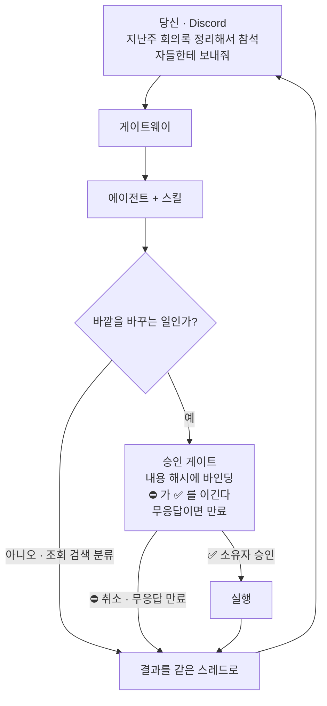
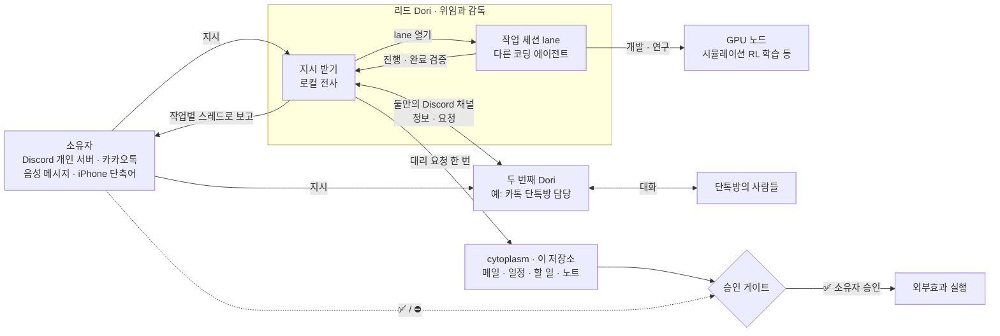

<div align="center">

# cytoplasm (사이토플라즘)

**연구자 한 사람이 자기 노드에서 돌리는 개인 에이전트 시스템.**<br>
메일·일정·회의록·노트를 대신 처리하지만, **내가 ✅ 를 누르지 않은 일은 절대 하지 않습니다.**

[](LICENSE)
[](#빠른-시작)
[](#빠른-시작)
[](https://github.com/orientpine/cytoplasm/tags)
[](#업데이트는-서명된-것만-설치됩니다)
[](#승인-게이트가-실제로-막는-것)

[빠른 시작](#빠른-시작) · [막힐 때](#막힐-때) · [무엇을 할 수 있나요](#무엇을-할-수-있나요) · [동작 방식](#동작-방식) · [FAQ](#자주-묻는-질문) · [보안](SECURITY.md)

</div>


---

## 빠른 시작

개발자가 아니어도 이 절만 위에서부터 따라 하면 됩니다. 컴퓨터에 **도리**(디스코드로 말을 걸면 일을 해 주는
비서 프로그램)를 깔고, 디스코드에서 첫 답장을 받는 데까지 갑니다. 처음 보는 말은 아래
[처음 보는 말 풀이](#처음-보는-말-풀이)에 한 줄씩 있습니다.

### 시작 전에 준비할 것

| 준비물 | 설명 |
|---|---|
| 컴퓨터 한 대 | 리눅스(우분투 등)·윈도우 10/11·macOS. 도리는 이 컴퓨터가 켜져 있을 때 답합니다 |
| 디스코드 계정 | 봇을 만들고 그 봇과 이야기할 개인 서버를 만듭니다(무료) |
| AI 구독 하나 | **Claude Pro/Max** 또는 **ChatGPT Plus/Pro**. 4단계에서 이 계정으로 로그인합니다 |
| 30분쯤 | 설치를 기다리는 몇 분 + 디스코드 봇 만들기 |

설치 한 줄을 실행한 뒤 사람이 할 일은 **셋**뿐입니다. ① 디스코드 봇 값 네 개를 파일에 넣기(2~3단계),
② 리드 탭에서 `/login` 으로 AI 구독에 로그인(4단계), ③ "Dori mode" 라고 말하기(5단계). 마지막 6단계에서
디스코드에 말을 걸어 답이 오는지 확인합니다.

### 1단계 — 설치 한 줄 실행

**리눅스·macOS** — 터미널을 엽니다(우분투는 `Ctrl`+`Alt`+`T`, macOS 는 `Cmd`+`Space` 를 누르고 「터미널」 입력).
아래 한 줄을 복사해 터미널에 붙여 넣고(리눅스 터미널은 `Ctrl`+`Shift`+`V`, macOS 는 `Cmd`+`V`) `Enter` 를 누릅니다.

```bash
curl -fsSL https://raw.githubusercontent.com/orientpine/cytoplasm/main/install.sh | bash
```

git 같은 기본 도구가 없으면 리눅스는 `sudo` 비밀번호(컴퓨터 로그인 비밀번호)를 묻습니다. 입력하는 동안 글자나 별표가
보이지 않는 게 정상이니 그대로 치고 `Enter` 를 누르세요. 터미널이 `curl: command not found`(curl 을 찾을 수 없음)라고 하면
먼저 `sudo apt update && sudo apt install -y curl` 을 실행한 뒤 위 한 줄을 다시 붙여 넣습니다.

**윈도우** — `시작` 버튼을 누르고 `powershell` 을 입력한 뒤 「Windows PowerShell」 을 그냥 클릭해 엽니다.
「관리자 권한으로 실행」 은 고르지 마세요(필요 없고, 그러면 AI 에이전트 설치가 건너뛰어집니다). 아래 한 줄을
복사해 파란 창에 붙여 넣고(`Ctrl`+`V` 또는 마우스 오른쪽 클릭) `Enter` 를 누릅니다. WSL 은 필요 없습니다.

```powershell
powershell -ExecutionPolicy Bypass -c "irm https://raw.githubusercontent.com/orientpine/cytoplasm/main/install.ps1 | iex"
```

몇 분 동안 글자가 흘러갑니다. 필요한 도구(git·Python·Bun·omo, 윈도우는 PowerShell 7 도)를 찾아 없으면 깔고,
내려받은 것이 진짜 배포본인지 서명으로 확인한 뒤 도리를 설치합니다. 마지막 즈음에 이 줄이 보이면 성공입니다.

```text
CYTO-LINUX-INSTALLED ...      (윈도우는 CYTO-WINDOWS-INSTALLED ...)
Update later: run the same line again. Open a new terminal so PATH picks up dori, herdr and omo.
```

**터미널(PowerShell) 창을 닫고 새로 엽니다.** 그래야 방금 깐 `herdr`·`dori`·`omo` 명령을 찾습니다.
중간에 멈추거나 빨간 글이 나오면 [막힐 때](#막힐-때)를 보세요.

설치기는 도리가 늘 깨어 있도록 상시 실행 장치도 켭니다. 리눅스는 사용자 서비스 `dori-serve.service`,
윈도우는 로그온 때 도는 작업 스케줄러 항목 두 개(「Dori herdr server」, 「Dori serve」)입니다. 사람이 따로 켤 것은 없습니다.

> [!NOTE]
> **macOS** 는 같은 한 줄로 설치되지만 상시 실행 장치가 없어 리드 탭과 디스코드 수신을 저절로 켜지 않습니다.
> 4단계에서 `herdr` 를 연 뒤 탭 하나에서 `omo` 를, 또 다른 탭에서 `dori serve` 를 실행해 두세요(재부팅하면 다시).

### 2단계 — 디스코드 봇 만들고 값 네 개 구하기

도리는 **내가 만든 봇**으로 디스코드에서 말합니다. 아래 네 값을 메모장(아무 메모 앱)에 모아 두세요.

| 값 | 무엇인가 | 넣을 줄 |
|---|---|---|
| 봇 토큰 | 봇의 비밀번호. **남에게 보이거나 어디에 올리면 안 됩니다** | `DORI_DISCORD_TOKEN` |
| 서버 ID | 봇과 이야기할 내 디스코드 서버의 번호 | `DORI_DISCORD_GUILD` |
| 채널 ID | 그 서버에서 도리와 이야기할 채널의 번호 | `DORI_DISCORD_CHANNEL` |
| 내 ID | 내 디스코드 계정의 번호. 도리는 이 사람의 말만 지시로 받습니다 | `DORI_DISCORD_OWNER` |

1. **내 서버와 채널 만들기.** 디스코드 앱 왼쪽 줄 맨 아래 「+」(서버 추가) → 「직접 만들기」 → 「나와 친구들을 위한 서버」 →
   이름을 정하고 만듭니다. 서버를 만들면 생기는 `#일반` 채널을 그대로 써도 되고, 채널 목록 옆 「+」 로 새 글 채널(예: `#dori`)을 만들어도 됩니다.
   이미 있는 내 서버를 써도 됩니다.
2. **봇 만들기.** 브라우저로 <https://discord.com/developers/applications> 에 디스코드 계정으로 들어가
   「New Application」 → 이름(예: Dori) → 「Create」.
3. **토큰 받기.** 왼쪽 메뉴 「Bot」 → 「Reset Token」 → 확인 → 나온 긴 글자를 「Copy」 해 메모합니다.
   토큰은 이때 한 번만 보입니다. 잃어버리면 다시 「Reset Token」 하면 됩니다(예전 토큰은 그때 못 쓰게 됩니다).
4. **글 읽기 권한 켜기.** 같은 「Bot」 화면 아래쪽 「Privileged Gateway Intents」 에서 **Message Content Intent** 를 켜고
   「Save Changes」. 이걸 빼먹으면 봇이 내 말을 읽지 못합니다.
5. **봇을 내 서버에 초대.** 왼쪽 메뉴 「OAuth2」 → 「URL Generator」 → Scopes 에서 `bot` 체크 →
   아래 Bot Permissions 에서 `View Channels`, `Send Messages`, `Send Messages in Threads`, `Create Public Threads`,
   `Manage Threads`, `Add Reactions`, `Read Message History`, `Attach Files` 를 체크 → 맨 아래 생성된 주소를 복사해
   브라우저 새 탭에 붙여 넣고 1에서 만든 서버를 골라 「승인」.
6. **개발자 모드 켜기(ID 복사용).** 디스코드 앱 왼쪽 아래 톱니바퀴(사용자 설정) → 「고급」 → 「개발자 모드」 켜기.
7. **ID 세 개 복사.** 왼쪽 줄의 내 서버 아이콘을 마우스 오른쪽 클릭 → 「서버 ID 복사」, 채널 이름을 오른쪽 클릭 →
   「채널 ID 복사」, 채팅에 보이는 내 이름(또는 왼쪽 아래 내 프로필)을 오른쪽 클릭 → 「사용자 ID 복사」. 셋 다 18~19자리 숫자입니다.

### 3단계 — 값 네 개를 `dori.env` 에 넣기

설치기가 만들어 둔 설정 파일 `dori.env` 를 엽니다.

```bash
nano ~/.dori/dori.env                               # 리눅스 (저장 Ctrl+O → Enter, 나가기 Ctrl+X)
open -e ~/.dori/dori.env                            # macOS (텍스트 편집기)
```

```powershell
notepad "$env:USERPROFILE\.dori\dori.env"           # 윈도우 (메모장, 저장 Ctrl+S)
```

파일 위쪽의 네 줄에서 `=` 뒤의 예시 값(`replace-with-your-bot-token` 과 1·2·3 이 18자리 늘어선 자리표시)만
2단계에서 모은 값으로 바꿉니다. 아래는 어느 줄에 무엇을 넣는지 보여 주는 그림입니다. 띄어쓰기나 따옴표는 넣지 않습니다.
`#` 으로 시작하는 줄과 나머지 줄은 그대로 둡니다.

```text
DORI_DISCORD_TOKEN=replace-with-your-bot-token     ← 봇 토큰
DORI_DISCORD_GUILD=서버-ID-숫자                      ← 서버 ID
DORI_DISCORD_CHANNEL=채널-ID-숫자                    ← 채널 ID
DORI_DISCORD_OWNER=내-사용자-ID-숫자                 ← 내 ID
```

저장하면 도리의 디스코드 수신이 다음 재시도(최대 5분) 때 저절로 붙습니다. 바로 붙이려면 리눅스는
`systemctl --user restart dori-serve`, 윈도우는 로그아웃했다가 다시 로그인합니다. 이 파일에는 비밀이 들어 있으니
남에게 보내거나 어디에 올리지 마세요.

### 4단계 — 리드 탭을 열고 `/login`

새 터미널(윈도우는 새 PowerShell)에서 `herdr` 를 입력하고 `Enter` 를 누릅니다. herdr 는 AI 에이전트 화면 여러 개를
한 창에 띄워 두는 프로그램이고, 마우스로 클릭해서 씁니다. 왼쪽 목록에서 **「짱돌」** 작업 공간(도리의 리드)을 클릭하면
AI 에이전트 omo 의 입력 화면이 보입니다. 리눅스는 브라우저 주소창에 `http://127.0.0.1:8181` 을 넣어도 같은 화면이 열립니다. 이때 비밀번호를 물으면
터미널에서 `grep HERDR_WEB_PASSPHRASE ~/.config/herdr/web-8181.env` 를 실행해 `=` 뒤의 값을 넣으세요.

1. 그 화면에 `/login` 을 입력하고 `Enter`.
2. 목록에서 내 구독을 고릅니다. Claude 를 쓰면 **Anthropic Subscription (Claude Pro/Max)**,
   ChatGPT 를 쓰면 **ChatGPT Subscription (Plus/Pro)**. 화살표 키로 옮기고 `Enter`.
3. 브라우저가 열리면 그 구독 계정으로 로그인하고 「허용」(Authorize)을 누릅니다. 브라우저가 열리지 않으면
   화면에 나온 주소를 복사해 브라우저에 붙여 넣습니다. 터미널로 돌아와 로그인됐다는 말이 나오면 끝입니다.

herdr 창을 닫아도 도리는 뒤에서 계속 돕니다. 다시 보려면 `herdr` 를 또 입력하면 됩니다.

### 5단계 — "Dori mode" 라고 말하기

같은 짱돌 화면에 `Dori mode` 라고 입력하고 `Enter`. 도리가 먼저 자기를 뭐라고 부를지 묻습니다. "Dori" 라고 해도 되고,
ShipDori 처럼 끝이 Dori 인 이름도 됩니다. 이름을 정하면 도리가 디스코드 채널과 연결하고 지시를 기다립니다.
다음에 다시 켤 때도 같은 화면에서 그 이름으로 "○○ mode" 라고 하면 됩니다.

### 6단계 — 잘 됐는지 확인: 디스코드에 말 걸기

2단계에서 ID 를 복사한 채널에 `안녕, 들려?` 라고 써 봅니다. 1~2분 안에 내가 만든 봇이 답하면 설치가 끝난 것입니다.
그다음부터는 그 채널에 하고 싶은 일을 보통 말로 쓰면 됩니다. 답이 없으면 바로 아래 [막힐 때](#막힐-때)를 보세요.

### 막힐 때

| 보이는 것 | 뜻과 할 일 |
|---|---|
| `CYTO-LINUX-NEEDS: …` 또는 `CYTO-LINUX-FAIL: …`(윈도우 `CYTO-WINDOWS-…`) | 그 줄이 무엇이 없는지 이름을 댑니다. 말한 것을 깔거나 고친 뒤 **같은 한 줄을 다시** 실행하세요. 여러 번 실행해도 안전합니다 |
| `…-FINGERPRINT-MISMATCH` | 내려받은 것이 공식 배포본과 다르다는 뜻이라 설치기가 일부러 멈췄습니다. 다시 시도하지 말고 이슈로 알려 주세요 |
| `CYTO-LINUX-OMO-SKIP` / `CYTO-WINDOWS-OMO-SKIP` | AI 에이전트 omo 를 못 깔았습니다(윈도우는 대개 관리자 창이라서). 짱돌 작업 공간은 만들어졌지만 그 안에 omo 가 켜지지 않은 상태입니다. 그 줄에 적힌 omo 설치 명령을 **일반** 터미널(PowerShell)에서 실행하고, 새 창에서 설치 출력의 `DORI-LEAD-PANE` 줄 끝에 있는 `herdr pane run …` 명령을 통째로 복사해 실행하면 짱돌 화면에 omo 가 켜집니다 |
| PowerShell 이 빨간 글로 실행 정책(ExecutionPolicy)을 말함 | 한 줄을 고치지 말고 위에 적힌 그대로 붙여 넣으세요. 이미 그 설정이 들어 있습니다 |
| 윈도우에서 `winget` 을 찾을 수 없음(회사 PC 등) | 세 가지를 직접 깝니다. 각 페이지에서 Windows 용 설치 파일을 받아 실행하고 기본값 그대로 「Next」 로 진행합니다. [git](https://git-scm.com/download/win), [Python](https://www.python.org/downloads/)(첫 화면 아래 「Add python.exe to PATH」 를 꼭 체크), PowerShell 7(Microsoft Store 에서 「PowerShell」 검색 후 설치). 그다음 PowerShell 창을 새로 열고 같은 한 줄을 다시 실행하세요 |
| `herdr`·`dori` 명령을 찾을 수 없음 | 터미널을 닫고 새로 여세요. 설치 직후의 창은 새 명령을 모릅니다 |
| herdr 에 「짱돌」 이 없음 | macOS 는 원래 만들지 않습니다. `herdr` 를 처음 열면 작업 공간 하나가 저절로 생기니, 그 화면에 `omo` 를 입력하고 `Enter` 를 눌러 4단계를 이어 가세요. 리눅스·윈도우에서 없으면 설치 출력에 `DORI-LEAD-FAIL` 줄이 있는지 보고 같은 한 줄을 다시 실행하세요 |
| 디스코드에서 답이 없음 | 아래 기록에서 `DISCORD_LISTENER_FATAL` 줄을 찾아보세요. `close=4004` 면 토큰이 틀렸습니다(2단계 3을 다시 하고 3단계에 새 토큰). `close=4014` 면 Message Content Intent 가 꺼져 있습니다(2단계 4). 그런 줄이 없으면 채널 ID·내 ID 가 맞는지, 봇이 그 채널을 볼 수 있는지(2단계 5) 확인하세요 |

디스코드 수신 기록을 보는 곳: 리눅스는 터미널에서 `journalctl --user -u dori-serve -n 50`, 윈도우는 PowerShell 에서
`notepad "$env:USERPROFILE\.dori\state\serve.log"` 를 실행하고 메모장에서 `Ctrl`+`F` 로 `DISCORD_LISTENER_FATAL` 을 찾습니다.

그래도 안 되면 [GitHub 이슈](https://github.com/orientpine/cytoplasm/issues)에 운영체제와 마지막에 나온 화면 몇 줄을
붙여 알려 주세요. **봇 토큰과 `dori.env` 내용은 절대 붙이지 마세요.** 설치 단계별 자세한 내용은
[설치 가이드](docs/guide/install.md#도리-기본-설치-p6)에 있습니다.

### 업데이트

새 릴리스가 나오면 **1단계의 같은 한 줄을 다시 실행**하면 됩니다. 넣어 둔 `dori.env` 와 설정은 그대로 남습니다.

옥돌·무돌·공돌 같은 선택 역할은 **처음 설치할 때** 고릅니다. 리눅스·macOS 는
`curl -fsSL https://raw.githubusercontent.com/orientpine/cytoplasm/main/install.sh | CYTO_ROLES=okdori,moodori bash`
(`bash` 바로 앞), 윈도우는 한 줄 전에 `$env:CYTO_ROLES="okdori,moodori"` 를 먼저 실행합니다. 이미 설치한 뒤에 더하는 방법은
[설치 가이드](docs/guide/install.md#도리-기본-설치-p6)의 `--role` 명령입니다. 예전 방식으로 서버에 깔아 운영하던 분은
[릴리스 서명키 교체 공지](#릴리스-서명키-교체-공지-2026-10-19)와 [직접 설치와 레거시 노드](#직접-설치와-레거시-노드)를 보세요.

### 처음 보는 말 풀이

| 말 | 뜻 |
|---|---|
| 도리(Dori) | 디스코드로 지시를 받아 일을 하고 결과를 알려 주는 상시 비서. 이 설치가 까는 것 |
| 짱돌(리드)·유돌(YooDori) | 기본으로 깔리는 두 역할. 짱돌은 지시를 받아 일을 나눠 맡기는 리드, 유돌은 메일·일정·할 일·문서를 맡는 비서 |
| 옥돌·무돌·공돌 | 원하면 더하는 선택 역할 |
| 터미널·PowerShell | 글자로 명령을 입력하는 창. 리눅스·macOS 는 「터미널」, 윈도우는 「PowerShell」 |
| omo | 도리 안에서 실제로 생각하고 일하는 AI 에이전트 프로그램. `/login` 으로 내 AI 구독에 연결 |
| herdr | 여러 AI 에이전트 화면(탭)을 한 창에 띄워 두는 프로그램. 창을 닫아도 뒤에서 계속 돎 |
| 리드 탭·작업 공간 | herdr 안에서 짱돌이 도는 화면. 도리가 일을 맡길 때는 일마다 새 탭(레인, lane)을 엽니다 |
| `dori.env` | 봇 토큰·ID 를 넣는 내 설정 파일. 비밀이 들어 있음 |
| 서명된 릴리스·지문 | 설치기가 내려받은 것이 진짜 배포본인지 자동으로 확인하는 장치. 사람이 할 일은 없음 |
| 승인 카드(✅/⛔) | 메일 발송처럼 바깥으로 나가는 일 전에 디스코드에 올라오는 확인 카드. ✅ 를 눌러야 실행 |
| Hermes·리컨실러·레거시 노드·프로필 | 예전 방식(서버 계정에 깔던 설치)의 이름. 새로 설치하는 분은 몰라도 됩니다 |


---

## 한눈에

에이전트에게 진짜 권한을 주면 곧바로 무서워집니다. 메일을 대신 써 주는 건 반갑죠. 그런데 내가
모르는 사이에 **보내 버리는** 건 전혀 다른 이야기잖아요.

그 두려움을 설계로 풀었습니다. 읽는 일은 마음껏 하되, 바깥 세상을 바꾸는 일은 전부 소유자 앞에
카드로 올라옵니다. 대충 이런 모습이에요.

```text
📬 메일 발송 승인 요청                                    #agent-chat › 메일 · 예산 문의 회신
──────────────────────────────────────────────────────────────────────────────
받는 사람 : (수신자)
제목      : Re: 2분기 집행 계획 문의
본문 요약 : 첨부한 표대로 진행하되, 항목 3은 다음 주에 다시 확인하겠다는 취지

action_hash : sha256:7f3c…a19b
만료        : 24시간 뒤 자동 취소

                                                              ✅ 보낸다   ⛔ 취소
```

✅ 를 누르면 그때 메일이 나갑니다. 아무것도 누르지 않으면 만료돼요. 승인한 뒤에 본문이 한 글자라도
바뀌면 해시가 어긋나 실행되지 않고요. 이 카드 하나가 저장소 전체의 요약입니다.

> [!IMPORTANT]
> **모든 외부효과는 소유자 본인의 승인을 거칩니다.** 이 한 문장이 설계의 중심이고, 나머지
> 코드는 대부분 그 불변식을 지키려고 존재해요.

---

## 목차

- [빠른 시작](#빠른-시작) — [막힐 때](#막힐-때) · [처음 보는 말 풀이](#처음-보는-말-풀이)
- [한눈에](#한눈에)
- [왜 이렇게 만들었나요](#왜-이렇게-만들었나요)
- [무엇을 할 수 있나요](#무엇을-할-수-있나요)
- [동작 방식](#동작-방식)
- [승인 게이트가 실제로 막는 것](#승인-게이트가-실제로-막는-것)
- [업데이트는 서명된 것만 설치됩니다](#업데이트는-서명된-것만-설치됩니다)
- [연합 모델 — 각자 자기 설치를 소유합니다](#연합-모델--각자-자기-설치를-소유합니다)
- [함께 쓰면 좋은 것 — Dori](#함께-쓰면-좋은-것--dori)
- [직접 설치와 레거시 노드](#직접-설치와-레거시-노드)
- [저장소 구조](#저장소-구조)
- [자주 묻는 질문](#자주-묻는-질문)
- [기여하기](#기여하기)
- [보안·버전·지원](#보안버전지원)
- [라이선스](#라이선스)

---

## 왜 이렇게 만들었나요

자동화에는 서로 잡아당기는 두 요구가 함께 붙어 있습니다. 사람이 매번 지켜보지 않아도 일이
굴러가야 하고, 동시에 **사람이 허락하지 않은 일은 결코 벌어지지 않아야** 하죠. 둘 다 지키려고
이 시스템은 네 가지를 택했습니다.

| 원칙 | 무슨 뜻인가 |
|---|---|
| **읽기는 자유, 쓰기는 게이트** | 조회·검색·분류는 그냥 한다. 메일 발송, 일정 등록, 문서 저장, 스킬 배포는 소유자의 ✅ 뒤에만 실행. 승인은 내용 해시에 묶여 있어서 승인 후 내용이 바뀌면 거부된다 |
| **막히면 멈춘다 (fail-closed)** | 설정이 없거나, 권한을 확인할 수 없거나, 판단이 모호하면 그냥 하지 않는다. 조용히 넘어가는 샛길을 일부러 만들지 않았다 |
| **커밋됨 ≠ 배포됨** | 프로덕션에서 도는 것은 불변 릴리스. 업데이트는 **서명된 릴리스 태그**에만 수렴하고, 실패하면 되돌린 뒤 소유자에게 알린다 |
| **신뢰 근원은 손이 닿지 않는 곳에** | 승인 판정과 서명 검증이 읽는 파일은 root 소유. 에이전트 계정이 그 파일을 고칠 수 있다면 검증 전체가 연극이 된다 |

이 네 줄은 문서로만 있는 약속이 아니에요. 각각을 지키는 테스트가 있고, 어기는 코드는 CI 에서
빨간불이 켜집니다.

---

## 무엇을 할 수 있나요

스킬 하나가 업무 영역 하나를 맡습니다. **승인** 열이 ✅ 면 실행 전에 반드시 카드가 올라온다는
뜻이에요.

| 스킬 | 하는 일 | 승인 |
|---|---|:---:|
| `mail` | 기관 웹메일 읽기·분류, 아침 다이제스트, 회신·새 메일 초안 작성 | ✅ 발송 |
| `calendar` | 일정 조회는 즉시, 등록·수정은 게이트 경유 | ✅ 등록 |
| `meeting` | 회의록 생성 — 결정사항·액션아이템·관리번호·과제별 원장까지 | ✅ 발행 |
| `speechtotext` | 녹취를 전사본으로. 화자 분리·이름 배정 포함, 음성은 노드 밖으로 나가지 않음 | — |
| `plaud` | 라이프로그 녹음을 노트로 만들어 개인 볼트에 넣기 | ✅ 쓰기 |
| `recall` | 개인 RAG 검색. 특허 민감 자료는 검증된 경로에서만 | 읽기 전용 |
| `wiki` | 개인 위키와 의사결정 트윈(판단 근거) 관리 | ✅ 쓰기 |
| `doctype` | 문서를 어디에 저장할지 결정론적으로 라우팅 | ✅ 저장 |
| `todo` | 할 일 등록·조회 | ✅ 등록 |
| `proposal` | 제안서 워크스페이스와 HWPX 문서 렌더링 | ✅ 산출 |
| `procurement` | 구매·조달 절차 안내와 서류 준비 | ✅ 산출 |
| `patent-prep` | 특허 준비 자료 정리 (소유자 승인 반출) | ✅ 반출 |
| `report` | 보고서 초안과 정기 리포트 | ✅ 산출 |
| `coordination` | 다른 연구자 에이전트와 일정 조율 (교착·재협상 규칙 포함) | ✅ 확정 |
| `repair` | 오류·실패를 수리 티켓으로 만들고 패치와 PR 까지 | ✅ 적용 |
| `prompt` | 프롬프트 자산 관리 | — |
| `hello-autophagy` | 스킬 구조를 보여주는 데모. 새 스킬은 여기서 출발 | — |

스킬은 직접 만들어 붙일 수 있어요. 배포는 샌드박스 → 리뷰 → 소유자 ✅ → 마운트의 4단계를
거칩니다. 자세한 목록과 상태는 [`docs/features.md`](docs/features.md), 스킬 작성 규약은
[`skills/AGENTS.md`](skills/AGENTS.md) 를 보세요.

---

---

## 동작 방식



요청 하나에 스레드 하나가 열립니다. 승인 카드도, 리마인더도, 실행·취소·만료 결과도 전부 그
스레드 안에서 끝나요. 끝나면 이름에 상태가 붙어 보관되고요. 그래서 **열려 있는 스레드 목록이
곧 진행 중인 일 목록**이 됩니다.

<details>
<summary><b>메일 한 통이 나가기까지 — 단계별로 펼쳐 보기</b></summary>

1. **수신·분류** — 받은 메일을 읽고 민감도를 먼저 판정해요. 특허 민감 자료는 검증된 경로가
   아니면 모델 호출 자체를 하지 않습니다.
2. **다이제스트** — 아침에 요약 한 건이 옵니다. 여기까지는 읽기라서 승인이 필요 없어요.
3. **초안** — "이렇게 답장해 줘" 라고 지시하면 회신 초안을 만듭니다. 회신에는 원문 인용이
   자동으로 붙고요.
4. **고유명사 확인** — 받는 사람이 이름으로만 적혀 있으면 주소를 추측하지 않아요. 주소록과
   대조해 확신이 설 때만 정규화하고, 애매하면 되묻습니다.
5. **승인 카드** — 수신자·제목·본문 요약과 `action_hash` 가 함께 올라옵니다.
6. **✅ 또는 ⛔** — 소유자 본인의 리액션만 유효해요. 봇이나 다른 사람의 반응은 무시되고,
   ✅ 와 ⛔ 가 함께 있으면 취소로 처리합니다.
7. **실행과 통지** — 발송한 뒤 결과가 같은 스레드로 돌아오고, 감사 원장에 한 줄 남습니다.

중간에 무엇 하나라도 확인되지 않으면 그 자리에서 멈춰요. 이것이 fail-closed 입니다.

</details>

---

## 승인 게이트가 실제로 막는 것

| 상황 | 어떻게 되나 |
|---|---|
| 승인 뒤 내용이 바뀜 | 해시가 어긋나 **실행되지 않는다** |
| 소유자가 아닌 사람이 ✅ | 무시. 리액션 주체와 봇 여부를 확인한다 |
| ✅ 와 ⛔ 가 함께 | **취소**로 처리 (외부효과는 안전한 쪽으로) |
| 아무도 누르지 않음 | 만료. 만료도 결과라서 스레드로 통지된다 |
| 같은 요청이 두 번 게시됨 | 게시하지 않는다. 요청 하나에 카드 하나가 강제된다 |
| 설정·권한을 읽을 수 없음 | 실행하지 않는다. 판단 불가는 승인이 아니다 |

승인 이모지는 어느 스킬에서나 같아요 — **✅ 는 실행, ⛔ 는 취소.** 외울 것은 이 둘뿐이고,
봇이 미리 붙여 두므로 탭 한 번이면 됩니다.

---

## 업데이트는 서명된 것만 설치됩니다

자동 업데이트는 편하죠. 하지만 잘못 만들면 "저장소에 push 할 수 있는 사람 = 내 노드에서 root 로
코드를 돌릴 수 있는 사람" 이 됩니다. 그래서 무엇을 설치할지는 **서명만이** 정해요.

- 노드의 리컨실러는 2분마다 돌지만, 설치 대상을 **인자로 받지 않습니다.** 게시된 릴리스 태그 중
  검증에 통과한 가장 최신 것으로만 수렴하죠.
- 서명 검증에 실패하면 그 틱은 아무것도 하지 않고 안전하게 건너뜁니다.
- 롤백 방지 앵커가 있어서 옛 릴리스를 다시 밀어 넣는 강제 다운그레이드가 막혀요. 문제가 있는
  릴리스는 되돌리는 게 아니라 **더 높은 버전으로 앞질러 고칩니다.**
- 서명 개인키는 어떤 저장소에도, CI 에도 두지 않고, 릴리스를 만드는 운영자 계정에만 있어요
  (노드의 서비스 계정은 읽지 못합니다). 노드의 신뢰 파일에 놓이는 것은 공개키 한 줄뿐입니다.

소프트웨어 업데이트와 스킬 배포는 **완전히 다른 채널**이에요. 스킬은 받아 두는 것까지만 자동이고,
실제로 켜는 일(live 마운트)은 언제나 그 설치 소유자의 ✅ 입니다.

업데이트 신뢰키가 바뀌면(2026-10-13·2026-10-19 회전 — 지금은 v2.6.6 부터 위 새 지문) 이미 설치한 서버는
새 키를 `/etc/autophagy/update-allowed-signers` 에 덧붙이기 전까지 옛 릴리스에 머뭅니다. 그때
리컨실러 저널·헬스체크에 `UPDATE-TRUST-STALE-KEY 신뢰 키 갱신 필요` 한 줄과 새 서명 키
지문이 남고, 덧붙이는 절차는 [install.md 「업데이트 신뢰키가 바뀌었을 때」](docs/guide/install.md#업데이트-신뢰키가-바뀌었을-때-이미-설치한-서버)에 있어요.

### 릴리스 서명키 교체 공지 (2026-10-19)

> [!IMPORTANT]
> 릴리스를 만드는 기계를 옮기면서 업데이트를 검증하는 서명키를 새로 만들었습니다.
>
> - v2.6.5 까지는 이전 키(`SHA256:NT5Ra3dsXhGg/+k6dvZaaE9epZcSuq4KuFGCMYQiang`), **v2.6.6 부터는 새 키**로 서명합니다. 새 키 지문: `SHA256:4yOZrMFmCSiSryt6+sal+E2hROpMlalgWNUqSf9lqsU`
> - 이미 설치한 서버가 이전 키만 믿고 있으면 **v2.6.5 에서 멈춰** 더 업데이트되지 않습니다. 리컨실러 로그·헬스체크에 `UPDATE-TRUST-STALE-KEY 신뢰 키 갱신 필요` 경고와 새 지문이 남습니다.
> - 운영자가 할 일: v2.6.6 릴리스에 붙은 `update-trust.pub` 를 받아 신뢰 파일에 덧붙입니다 — `trust_key_bootstrap.py install --add` 명령 전체는 [install.md 「업데이트 신뢰키가 바뀌었을 때」](docs/guide/install.md#업데이트-신뢰키가-바뀌었을-때-이미-설치한-서버)에 있습니다.
> - 확인: `python3 /srv/autophagy-agent-current/automation/install/trust_key_bootstrap.py verify --expect-fingerprint 'SHA256:4yOZrMFmCSiSryt6+sal+E2hROpMlalgWNUqSf9lqsU'` 의 마지막 줄이 `TRUSTED` 이면 됩니다(2분 안에 최신 릴리스로 따라옵니다).
> - 이전 교체(2026-10-13): v1.22.2 까지는 `SHA256:0imCAjLaEFCB8oNX05/7mHFQAZsL722KIEZsVD5yvrA`, v1.22.3~v2.6.5 는 `SHA256:NT5Ra3dsXhGg/+k6dvZaaE9epZcSuq4KuFGCMYQiang` 였습니다.

---

## 연합 모델 — 각자 자기 설치를 소유합니다

여러 연구자가 함께 써도 **중앙 서버도, 멀티테넌트 호스팅도, 공용 계정도 없습니다.** 각자 자기
호스트에 자기 설치를 갖죠. 자기 봇, 자기 자격증명, 자기 데이터, 그리고 자기 승인 게이트.

그러면 "그룹"이란 무엇일까요? 그룹은 서비스가 아니라 **공급망·정책 경계**이고, 물리적 구성물은
정확히 셋뿐입니다.

1. 그룹 관리자가 소유한 **관리형 스킬 저장소**
2. 관리자의 **서명키 1쌍** — 개인키는 관리자만, 팀원은 공개키만 갖는다
3. **roster** — 팀원 명단

이 셋 말고 그룹을 표현하는 서버나 DB 는 없고, 앞으로도 만들지 않아요. 그래서 그룹 관리자가
**할 수 없는 일**이 분명합니다.

- 팀원 설치의 외부효과를 **대리 승인할 수 없어요.** 승인 게이트는 팀원 본인 것이니까요.
- 팀원의 자격증명·메일·노트·대화를 **볼 수 없습니다.**
- 이미 팀원 노드에 올라간 스킬은 **원격으로 거둬들이지 못합니다.** 관리자의 권한은
  배포 키 폐기와 취소(revocation) 발행까지. 실제 제거는 그 설치의 소유자 몫이에요.

마지막 항목은 결함이 아니라 "각자 자기 설치를 소유한다"의 직접적인 귀결이에요. 두 채널이
서로 다르다는 점도 중요합니다 — **소프트웨어 업데이트는 업스트림에서 직접** 받고, **스킬은 그룹
관리자에게서** 받아요. 그룹 관리자가 소프트웨어 유지보수자일 필요는 없습니다.

한 설치는 v1 에서 하나의 그룹에만 속해요. 역할별 매뉴얼은 따로 있습니다 —
[팀원](docs/guide/manual-member.md) · [그룹 관리자](docs/guide/manual-group-admin.md) ·
[유지보수자](docs/guide/manual-maintainer.md).

---

## 함께 쓰면 좋은 것 — Dori

[**Dori 모드**](https://github.com/orientpine/omo-dori-mode-experimental) 는 코딩 에이전트를 상시
메신저 비서로 바꾸는 스킬이에요. 메신저로 지시를 받으면 herdr 탭(lane)을 열어 실제 작업을
다른 코딩 에이전트에게 맡기고, 끝날 때까지 추적해 작업별 스레드로 보고합니다. Discord 질문 카드,
스레드 상태 이모지, "끝났다"는 주장을 5분 안에 실제 상태로 검증하는 규칙, iPhone 단축어 음성
지시까지 들어 있어요.

이 저장소와 겹치지 않고 서로 비어 있는 자리를 채워서 **같이 쓰면 좋습니다.** Dori 는 개발·연구
같은 일을 맡겨 감독하고, 메일·일정·할 일·노트 같은 연구 행정은 승인 게이트를 가진 이 저장소가
맡는 식이죠. 실제로 이렇게 나눠 쓰고 있어요.



- **리드 Dori** 는 소유자의 Discord 채널에서 지시를 받아(음성은 로컬에서 전사) 일을 lane 으로
  나눠 맡기고, 진행과 완료를 직접 확인해 보고합니다. 메일 발송 같은 행정은 직접 하지 않고
  cytoplasm 채널에 대리 요청 한 번으로 넘겨요.
- **두 번째 Dori** 는 예를 들어 카카오톡 단톡방을 맡아 사람들과 대화합니다. 소유자가 직접 말하기도 하고(전용
  Discord 채널·카톡방), 리드 Dori 와는 둘만의
  Discord 채널로 정보와 요청을 주고받습니다. 외부효과가 있는 일은 소유자에게 확인받고요.
- **cytoplasm** 은 연구 행정의 외부효과를 맡고, 그 일은 언제나 소유자의 ✅ 뒤에만 실행됩니다.

경계가 분명한 것이 핵심이에요 — Dori 는 위임과 감독, 두 번째 Dori 는 대화, cytoplasm 은 승인을
거친 행정 외부효과. 어느 쪽도 다른 쪽의 일을 대신 하지 않습니다.

---

## 직접 설치와 레거시 노드

빠른 시작의 한 줄 대신 저장소 체크아웃에서 설치기를 직접 부르거나, 예전 방식(Hermes 게이트웨이·서비스 계정·리컨실러
타이머를 쓰는 서버 노드)을 운영하는 분을 위한 절입니다. 처음 설치하는 분은 읽지 않아도 됩니다.

### 도리 기본 설치 — 체크아웃에서 직접

신규 설치는 고정된 도리 포크와 리드+YooDori 역할을 준비합니다. 옥돌·무돌·공돌은 선택이며
Hermes는 설치하지 않습니다. Python 3.11 이상, 실제 설치에는 git·Bun이 필요합니다.
봇 토큰·채널·모델 로그인은 설치별로 준비합니다.

```bash
python3 -m automation.install --dry-run
python3 -m automation.install.wizard
```

마법사 첫 항목과 빈 입력은 도리입니다. `--dori-role okdori`·`--dori-role moodori`·`--dori-role gongdori`로
선택 역할을 더합니다. 도리 CLI·역할 설치와 기존 업무 노드의 업그레이드는 구분합니다.
[설치 가이드](docs/guide/install.md)와 [도리 기반 메이저 소개](docs/기능소개/도리-기반-메이저.md)를
먼저 읽으세요. 이미 전환된 노드는 설치기를 재실행하지 않고 기존 서명 릴리스로 업데이트하며,
멈춘 Hermes 잡·계정·유닛을 지우지 않습니다.

### 필요한 것

도리 기본 설치는 Linux·macOS·윈도우(네이티브)에서 돕니다. 아래 표는 레거시 노드용입니다.

아래 절차는 기존 노드 유지보수를 위해 `--profile core|rag|report-hub|full`을
명시한 경우에만 적용됩니다. 기본 도리 경로의 전제가 아닙니다.

| 항목 | 값 |
|---|---|
| 운영체제 | **Linux + systemd** (리컨실러·워처가 systemd 타이머) |
| 권한 | 설치에 `root`. 계획 확인(dry-run)은 root 없이 가능 |
| 파이썬 | 3.12 이상 |
| 그 밖에 | Discord 앱·봇, 모델 provider, Hermes 게이트웨이, 업데이트 신뢰키 |

전제 준비의 정본은 [`docs/guide/third-party-runtime-prereqs.md`](docs/guide/third-party-runtime-prereqs.md)
입니다. 처음 받은 분은 표지 문서 [`docs/guide/quickstart-install.md`](docs/guide/quickstart-install.md)
부터 펼치세요. 설치 절차 전체의 단일 진실은 [`docs/guide/install.md`](docs/guide/install.md) 이고요.

### 레거시 1단계 — 지문부터 대조합니다

`<bundle>/update-trust.pub` 은 각 릴리스에 asset 으로 동봉되는 업데이트 신뢰키의 공개키예요.
그 지문은 이 README 와 릴리스 노트에 공지되는데, **키와 다른 경로로 받은 지문**을 설치기에
넘겨 대조하는 것이 이 부트스트랩의 핵심입니다. 마법사도 설치기도 지문을 지어내지 않아요.

```
SHA256:4yOZrMFmCSiSryt6+sal+E2hROpMlalgWNUqSf9lqsU
```

사람이 직접 판단해야 하는 지점은 사실상 여기 하나뿐입니다.

### 레거시 2단계 — 설치 마법사 (권장)

```bash
python3 -m automation.install.wizard \
    --profile core \
    --update-trust-key <bundle>/update-trust.pub \
    --expect-update-trust-fingerprint 'SHA256:4yOZrMFmCSiSryt6+sal+E2hROpMlalgWNUqSf9lqsU'
```

마법사는 프로필(`core`·`rag`·`report-hub`·`full`), 업데이트 origin URL, 호스트 이름, 운영자
계정을 묻고 `~/.config/autophagy/node.toml` 을 대신 써 줍니다. 그다음 root 없이 설치 계획을
받아 한국어 요약을 보여주고, `yes` 를 입력해야만 `sudo` 로 실제 설치에 들어가요. 설치 로직은
여전히 아래 설치기 하나가 소유합니다 — 마법사는 그 인자를 조립할 뿐이죠.

- `--profile core` 처럼 값을 미리 주면 그 질문은 건너뜁니다. `--config PATH` 로 위치를 바꾸거나
  이미 있는 config 를 그대로 재사용해도 되고요.
- `--dry-run-only` 는 계획 확인에서 끝납니다(`sudo` 0회). `--yes` 는 비대화 실행 전용이에요.
- 확인 질문에 `n` 을 답하면 rc 3 으로 멈추고 아무것도 설치하지 않습니다.
- 설치 전에 사람이 준비할 승인(Codex 구독 로그인·Discord 봇·Google 동의 등)을 먼저 보여 주고, 설치가 끝나면
  `python3 -m automation.doctor` 로 하나씩 확인·안내합니다. 승인한 뒤 Enter 를 누르면 다시 점검해요.
  설치 뒤에는 매시간 점검해 끊긴 연결이 **생기거나 풀릴 때만** 알려 줍니다
  ([연결·승인 점검](docs/guide/연결-승인-점검.md)).

### 레거시 3단계 — 설치기 직접 실행 (스크립트·수동)

config 를 [install.md §3](docs/guide/install.md) 대로 손으로 쓰거나, 마법사가 만든 파일을 그대로
주고 같은 설치기를 부르세요.

```bash
# 무엇이 설치될지 먼저 봅니다 — root 불필요, 아무것도 쓰지 않습니다
python3 -m automation.install \
    --config ~/.config/autophagy/node.toml \
    --profile core \
    --update-trust-key <bundle>/update-trust.pub \
    --expect-update-trust-fingerprint 'SHA256:4yOZrMFmCSiSryt6+sal+E2hROpMlalgWNUqSf9lqsU' \
    --dry-run

# 실제 설치 — 멱등입니다. 막히면 고치고 같은 명령을 다시 실행하세요
sudo python3 -m automation.install \
    --config ~/.config/autophagy/node.toml \
    --profile core \
    --update-trust-key <bundle>/update-trust.pub \
    --expect-update-trust-fingerprint 'SHA256:4yOZrMFmCSiSryt6+sal+E2hROpMlalgWNUqSf9lqsU'
```

명시적 레거시 `--profile`은 이 노드가 운영하는 묶음의 헬스체크 선언을 root 소유 파일로
고정합니다. 프로필을 생략하면 위 도리 기본 설치로 갑니다.

설치가 끝난 뒤의 사용법은 [`docs/guide/manual-member.md`](docs/guide/manual-member.md) 가 이어받습니다.

---

## 저장소 구조

```text
configs/        # 노드 config·라우팅 정책·환경 템플릿 등 설정 시드
skills/         # 에이전트 스킬 (메일·캘린더·문서·위키·할일 …)
automation/     # 오케스트레이션·승인 게이트·워처·배포·설치기
  install/      # 단일 노드 설치기 (python3 -m automation.install)
prompts/        # 프롬프트 자산
tests/
  unit/         # 단위 테스트
  e2e/
    scenarios/  # E2E 시나리오
docs/
  guide/            # 가이드 문서 (설치·전제·운영·규약)
  patch/            # 패치 노트
  기능소개/          # 기능별 소개 (무엇을·왜·어떻게 쓰는가)
  troubleshooting/  # 트러블슈팅
logs/           # 로그 (git 미추적, 디렉토리만 유지)
```

예전 이름은 `autophagy-agents` 였고, 일부 경로·문서에 그 이름이 남아 있습니다.

`.omo/`(계획·오케스트레이션 상태)와 `docs/qa/`(QA 증적)는 비공개 개발 저장소 전용이라 공개
배포본에는 들어 있지 않아요.

설계 규약과 코드 지도는 [`AGENTS.md`](AGENTS.md) 에 있습니다. 이 저장소에서 무언가를 고칠
생각이라면 그 문서를 먼저 읽는 편이 빨라요.

---

## 자주 묻는 질문

<details>
<summary><b>중앙 서버가 필요한가요?</b></summary>

필요 없어요. 설치 하나가 곧 완결된 시스템입니다. 여러 명이 함께 쓰더라도 공유되는 것은
스킬 저장소·서명키·명단 셋뿐이고, 그마저도 그룹을 쓸 때만 필요하죠.

</details>

<details>
<summary><b>그룹 관리자가 제 메일이나 노트를 볼 수 있나요?</b></summary>

볼 수 없습니다. 자격증명도 데이터도 각자의 호스트에만 있으니까요. 관리자가 보내는 것은 서명된
스킬 릴리스이고, 그것을 켤지 말지도 받는 사람이 정해요.

</details>

<details>
<summary><b>승인을 깜빡하면 어떻게 되나요?</b></summary>

만료됩니다. 만료도 하나의 결과라서 요청 스레드로 통지가 돌아오고, 실행은 일어나지 않아요.
급하지 않은 일이 조용히 사라지는 게 아닙니다. 조용히 **안 한 채로** 끝나죠.

</details>

<details>
<summary><b>승인한 뒤에 내용이 바뀌면요?</b></summary>

실행되지 않아요. 승인은 내용의 sha256 해시에 묶여 있어서, 실행 직전에 다시 계산한 해시가
다르면 그 자리에서 거부합니다. "승인은 받았으니 조금 고쳐서 보내자" 가 불가능한 구조죠.

</details>

<details>
<summary><b>음성 녹취나 문서가 외부로 나가나요?</b></summary>

전사는 기본적으로 노드 안에서 로컬 모델로 처리해서 원음을 외부 API 로 보내지 않아요.
회의록에는 민감 판정이 없어요 — 운영자와 구성원이 모두 보안 관리자 등급이라 문서 단위로
막을 필요가 없어졌거든요. 메일·보고서 같은 다른 스킬은 특허 민감으로 분류된 자료라면
검증된 경로가 아닌 한 모델 호출 자체를 하지 않고요.

</details>

<details>
<summary><b>Windows 나 macOS 에서도 되나요?</b></summary>

윈도우는 도리 기본 설치라면 됩니다. WSL 없이 PowerShell 한 줄로 설치하고, 같은 줄로
업데이트해요. 상시 실행은 작업 스케줄러 두 항목이 맡습니다. 레거시 `--profile` 노드 인프라,
herdr 웹, 레인 체크포인트, 분리 인수인계, `dori heavy`, 송신 게이트, 음성 설정은 Linux 전용으로 남아요.

macOS 에서는 도리 설치기가 포크·역할·herdr 까지 깔지만 systemd 가 없어 herdr 서버·웹 유닛은
건너뜁니다. 그래서 재부팅 뒤 루프를 살려 두는 장치가 없어요. 직접 띄워야 합니다.
Linux·macOS 업데이트는 `python3 -m automation.install.update` 입니다.

</details>

<details>
<summary><b>스킬을 직접 만들 수 있나요?</b></summary>

만들 수 있어요. `skills/hello-autophagy/` 가 최소 예제이고, 배포는 샌드박스 → 리뷰 →
소유자 ✅ → 마운트의 4단계를 거칩니다. 이미 비슷한 스킬이 있으면 만들기 전에 그것을
알려주는 대조 게이트도 있고요.

</details>

<details>
<summary><b>나쁜 릴리스가 나가면 어떻게 하나요?</b></summary>

옆으로도 뒤로도 가지 않고 앞으로만 고칩니다. 문제를 되돌리는 커밋을 넣고 **더 높은 버전**을
새로 컷해요. 옛 태그를 다시 밀어 넣는 방식은 롤백 방지 앵커가 거부합니다 — 강제 다운그레이드
공격과 구분할 방법이 없거든요.

</details>

---

## 기여하기

관심 가져 주셔서 고맙습니다. 먼저 알아 두실 것이 하나 있어요.

> 코드는 **비공개 개발 저장소**에서 관리되고, 공개 저장소는 서명된 릴리스마다 갱신되는
> **일방향 배포본**입니다. 그래서 공개 저장소에 올린 Pull Request 는 머지되지 않아요.

그렇다고 참여할 길이 없는 건 아닙니다.

- **버그·제안** — 이슈로 남겨 주세요. 재현 절차와 로그(민감정보는 가려서)가 있으면 가장 좋아요.
- **문서** — 설치하다 막힌 지점, 설명이 부족한 문단은 특히 반갑습니다. 대개 그 자리가 진짜
  결함이거든요.
- **보안 문제** — 공개 이슈로 올리지 말고 [`SECURITY.md`](SECURITY.md) 의 보고 경로를 따라
  주세요.
- **패치** — 이슈에 diff 나 패치 파일을 붙여 주시면 상류에서 검토해 반영합니다.

이 저장소의 코드 규약, 커밋 스타일, 승인·배포 불변식은 [`AGENTS.md`](AGENTS.md) 가 단독으로
소유해요. 무엇이 왜 그렇게 되어 있는지 궁금할 때 가장 먼저 볼 문서입니다.

---

## 보안·버전·지원

취약점을 발견했다면 공개 이슈로 올리지 말고 [`SECURITY.md`](SECURITY.md) 의 보고 경로를
따라 주세요. 거기에 응답 약속과 지원 범위도 함께 적혀 있습니다.

릴리스 버전과 설정·roster·매니페스트 스키마 버전은 서로 독립적으로 움직여요. 그 관계와,
`~/.hermes/**` 상태 파일이 새 코드에서 거부될 때의 대응 절차는
[`docs/guide/versioning-support.md`](docs/guide/versioning-support.md) 에 있습니다.

---

## 라이선스

[Apache-2.0](LICENSE) 으로 배포합니다. 특허 grant 가 명시되어 있어 특허 인접 연구 맥락에
적합하다고 판단했어요. `skills/mail/vendor/` 의 vendored 소스와 그 출처·의존성 정보는
[`skills/mail/vendor/NOTICE`](skills/mail/vendor/NOTICE) 에 기록되어 있습니다.

설치되는 도리 포크에는 원본 dori-superagent에서 온 Sustainable Use License 1.0(SUL-1.0) 부분이 들어 있거나 앞으로 들어옵니다(어느 부분인지는 포크의 [NOTICE](https://github.com/orientpine/omo-dori-mode-experimental/blob/main/NOTICE)). 그래서 사이토플라즘·도리 기본 설치는 비상업 목적으로, 무료일 때만 남에게 나눠 줄 수 있습니다. 사이토플라즘 자체 코드의 라이선스(Apache-2.0)는 그대로입니다.

<div align="center">
<br>

**읽어 주셔서 고맙습니다.**<br>
쓸모 있어 보인다면 ⭐ 를 눌러 주세요. 어디가 막혔는지 알려 주시면 그게 다음 문서가 됩니다.

</div>
