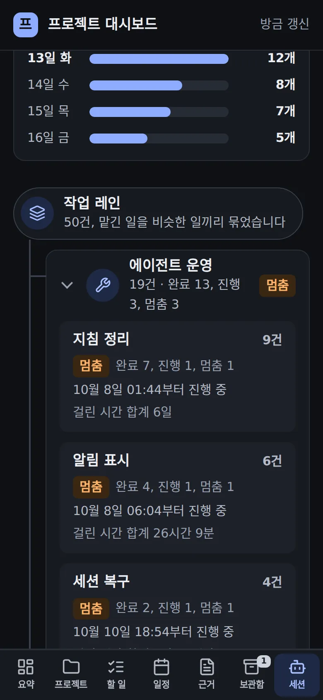
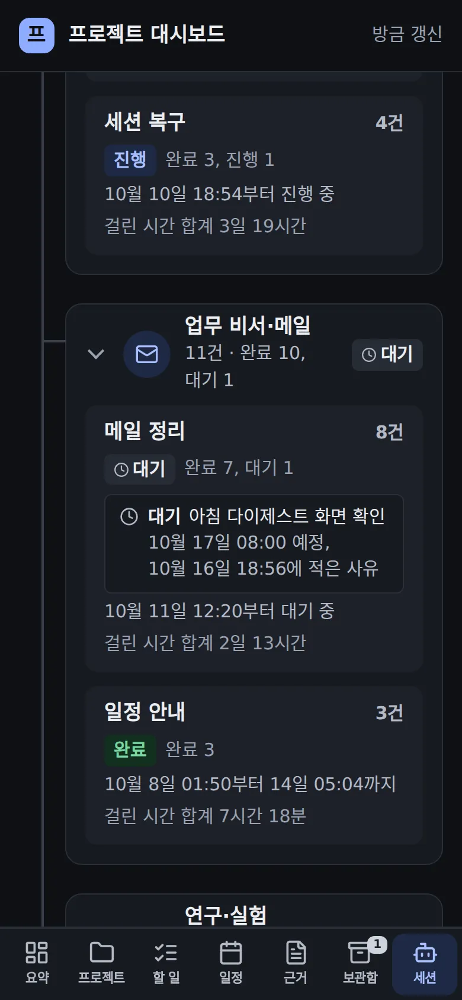
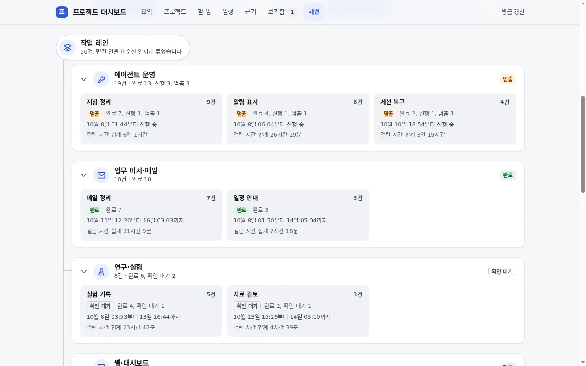
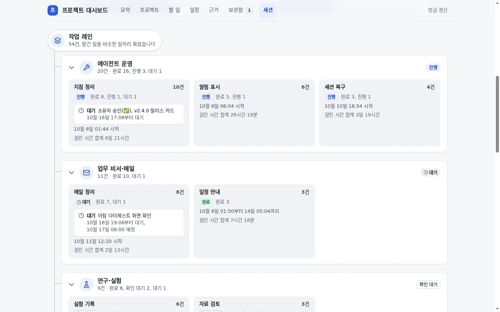
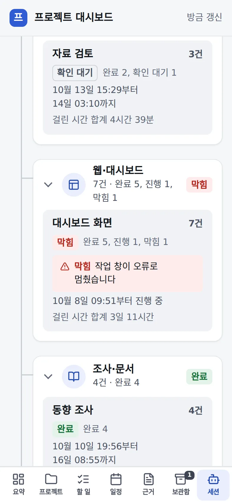

# 세션 탭: 기다리는 레인은 「대기」, 정말 멈춘 레인만 「막힘」

## 무엇을
대시보드 세션 탭에서 사람이나 정해진 시각을 기다리며 쉬어 둔 작업 레인을 「멈춤」이 아니라 **「대기」**(시계 아이콘, 중립색)로 보여 준다.
그 레인이 든 카드에는 무엇을 언제 기다리는지 한 줄이 붙는다. 예: 「대기 아침 다이제스트 화면 확인 · 10월 16일 18:56부터 대기, 10월 17일 08:00 예정」.
카드의 기간 줄은 상태 말 없이 「10월 11일 12:20 시작」처럼 묶음이 언제 시작했는지만 말한다.
작업 창이 오류나 입력 대기로 멈췄거나 꺼진 레인만 **「막힘」**(빨강)이고, 그 이유도 한 줄로 붙는다.
묶음 머리와 개요의 건수도 「완료 12, 대기 1」, 「막힘 1」로 따로 센다.

## 왜
2026-10-16 소유자 질문: "메일 정리·전달 13건 멈춤 완료 12, 멈춤 1 … 왜 멈춤으로 되어 있어?"
그 1건은 다음 날 아침 다이제스트를 실제 화면에서 확인하려고 쉬어 둔 레인이었다. 세션 탭은 쉬어 둔 레인과 정말 멈춘 레인을
같은 「멈춤」(주황)으로 그렸고, 무엇을 기다리는지는 어디에도 없었다. 그래서 기다리는 일이 고장처럼 보였다.

## 전과 후 (지어낸 데모 데이터)
| 화면 | 전 | 후 |
|---|---|---|
| 휴대폰, 어두운 모드 |  |  |
| 데스크톱, 밝은 모드 |  |  |
| 막힘(휴대폰) | 표시 없음 |  |

## 사용 시나리오
- 레인이 다음 날 08:06 다이제스트 확인을 기다리며 쉬고 있다. 세션 탭을 열면 「업무 비서·메일」 묶음 머리에 시계와 「대기」가 있다.
  펼치면 「메일 정리·전달」 카드에 「대기 기관메일 다이제스트 라이브 확인 · 10월 16일 21:57부터 대기, 10월 17일 08:06 예정」이 보인다.
  카드의 기간 줄은 「10월 12일 09:12 시작」이라, 그때부터 기다린 것처럼 읽히지 않는다.
- 예정 시각이 지나도 레인이 그대로면 그 줄에 「시각 지남」이 붙는다. 「…부터 대기」는 그 사유를 적고 쉬어 둔 시각이라, 사유가 오래돼
  지금과 다를 수 있음도 그 시각으로 알 수 있다.
- 영어로 적은 사유는 정해진 한국어 문구로 바뀐다: 「소유자 승인(✅), v1.40.0 릴리스 카드」, 「소유자 결정, 질문 Q12」, 「소유자 지시로 보류」.
- 작업 창이 오류로 멈추면 그 묶음 머리가 빨간 「막힘」이 되고 카드에 「막힘 작업 창이 오류로 멈췄습니다」가 붙는다.
  자기 감시를 기다리며 턴을 끝낸 레인은 막힘이 아니라 진행이다.
- 사유에 경로·링크·카드 번호·커밋 해시가 섞여 있어도 작업 컴퓨터에서 먼저 지우고 보낸다. 노드도 화면에 내기 전에 한 번 더 거른다.
  레인 이름과 제목은 예전처럼 보내지 않는다.

## 관련
- 코드: `automation/project_board/session_feed/collect.mjs`(`waitReason`·`scheduledAt`, `wait`·`block`), `sessions.py`(`why`·`since`·`until`,
  옛 `hold` 를 대기로 읽음), `sessions_view.py`(배지·사유 줄), `dashboard_theme.py`(`.st-wait`·`.ss-note`), 데모 `demo.py`.
  시험: `tests/unit/test_project_board_sessions.py`.
- 규약: [프로젝트 대시보드 §4 「세션 탭」](../guide/프로젝트-대시보드.md), [세션 현황판 7.4](../guide/세션-현황판.md).
- 승인·외부효과 없음(읽기만). 작업 컴퓨터 수집기는 노드가 새 화면을 받은 뒤 갱신된다. 예전 수집기가 보내는 `hold` 도 대기로 읽으므로 순서가 바뀌어도 화면은 깨지지 않는다.
