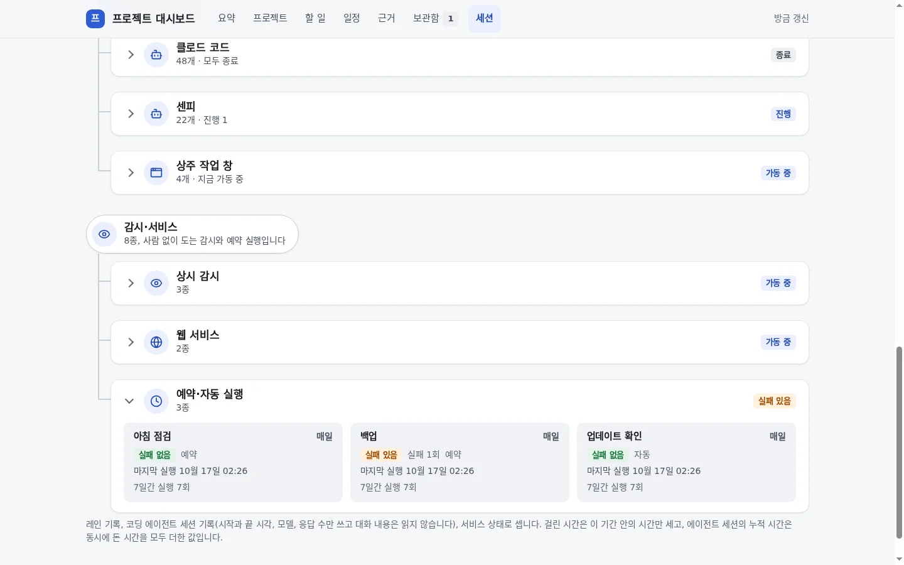
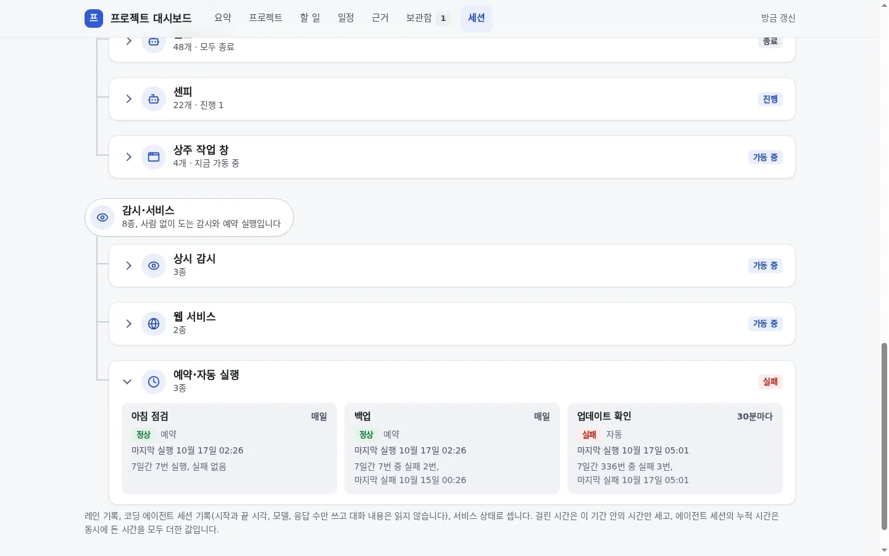
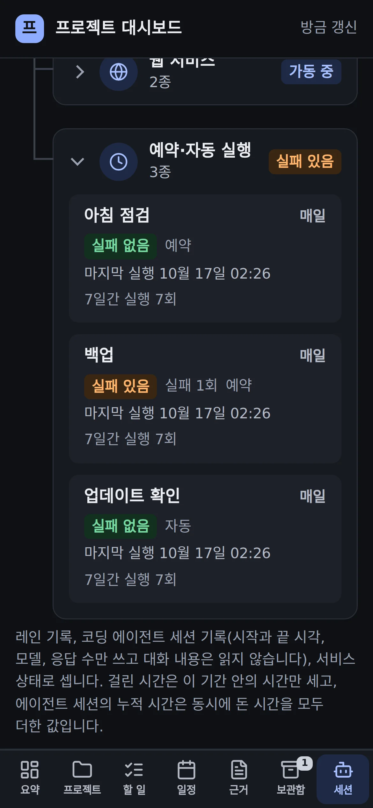
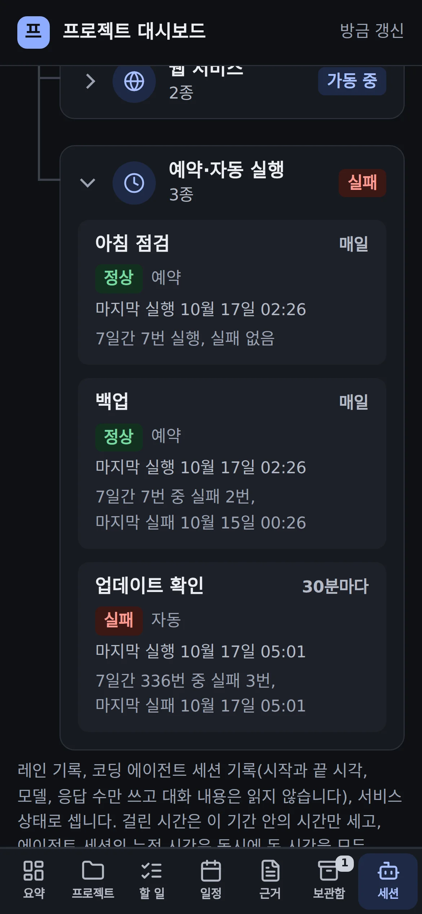

# 세션 탭: 예약 작업은 마지막 실행 결과로 「정상」·「실패」

## 무엇을
대시보드 세션 탭의 「예약·자동 실행」 카드가 **마지막 실행이 어떻게 끝났는지**로 상태를 말한다.
마지막 실행이 정상이면 **「정상」**(초록), 실패로 끝났으면 **「실패」**(빨강)다.
그 주의 지나간 실패는 지우지 않는다. 카드 아래 한 줄에 「7일간 2,082번 중 실패 5번, 마지막 실패 10월 17일 04:25」처럼 남는다.
실패가 없던 작업은 「7일간 7번 실행, 실패 없음」이다.

## 왜
2026-10-17 05:28 소유자 질문: "릴리스 마무리 확인 … 실패 있음 실패 5회 … 이것도 확인해".
그 5번은 모두 지나간 일이었다. 3번은 이틀 전에 이미 고친 배포 판정 문제였고, 2번은 그날 새벽 04:23·04:25의 DNS 끊김이었다.
다음 실행부터는 계속 정상이었다. 그런데 세션 탭은 7일 안에 한 번이라도 실패한 작업을 「실패 있음」(주황)으로 그렸고
마지막 실행이 어땠는지는 보여 주지 않았다. 그래서 지나간 실패가 지금 고장처럼 보였다.

## 전과 후 (지어낸 데모 데이터)
| 화면 | 전 | 후 |
|---|---|---|
| 데스크톱, 밝은 모드 |  |  |
| 휴대폰, 어두운 모드 |  |  |

데모의 「백업」은 그 주에 두 번 실패했지만 그 뒤로 정상이라 「정상」이고, 「업데이트 확인」은 마지막 실행이 실패해 「실패」다.

## 사용 시나리오
- 릴리스 마무리 확인이 새벽에 네트워크가 끊겨 두 번 실패하고 다음 실행부터 정상이다. 세션 탭을 열면 그 카드는 「정상」이고
  아래에 「7일간 2,089번 중 실패 5번, 마지막 실패 10월 17일 04:25」가 있다. 지금 손볼 것이 없다는 것과 언제 실패했는지가 함께 보인다.
- 어떤 예약 작업이 지금 실패하고 있다. 그 카드는 빨간 「실패」이고 묶음 머리 「예약·자동 실행」도 「실패」가 된다.
  「실패」가 보이면 지금 실제로 실패 중인 작업이다.
- 한 라벨에 유닛이 여럿이면 그중 하나라도 마지막 실행이 실패로 끝났을 때 「실패」다.
- 마지막 결과를 보내지 않는 예전 수집기의 집계가 오면 예전처럼 「실패 있음 · 실패 N회」로 보인다. 마지막 결과를 모를 때는
  지금 괜찮다고 말하지 않는다.

## 관련
- 코드: `automation/project_board/session_feed/collect.mjs`(예약 행의 `lastOk`·`lastFail`), `sessions.py`(두 칸 읽기, 틀린 값이면 집계 전체를
  읽지 않음), `sessions_view.py`(`_timer_member`, 배지 「정상」·「실패」), 데모 `demo.py`. 시험: `tests/unit/test_project_board_sessions.py`.
- 규약: [프로젝트 대시보드 §4 「세션 탭」](../guide/프로젝트-대시보드.md), [세션 현황판 7.4 「마지막 실행」](../guide/세션-현황판.md).
- 승인·외부효과 없음(읽기만). 노드는 모르는 칸을 무시하므로 작업 컴퓨터 수집기와 노드 중 어느 쪽이 먼저 갱신돼도 화면은 깨지지 않는다.
