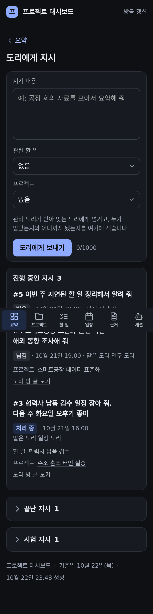
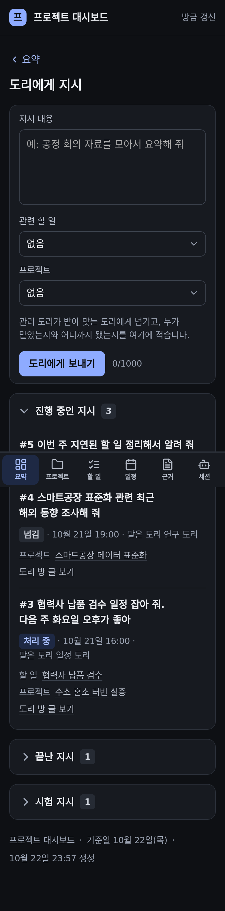
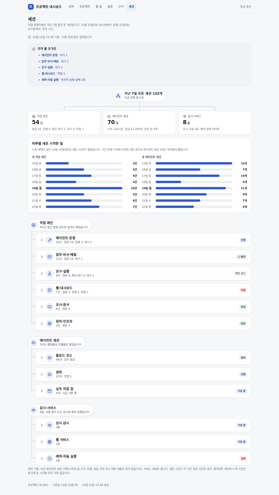
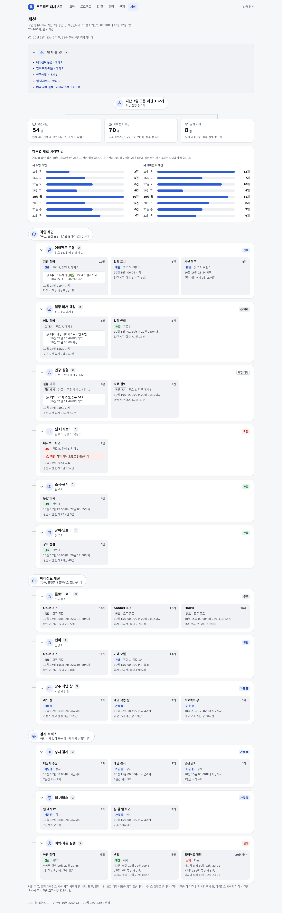

# 프로젝트 대시보드 — 모든 목록을 같은 방식으로 접기

## 무엇을

대시보드의 목록 묶음은 모두 같은 접기 하나를 쓴다. 머리(꺾쇠 · 제목 · 개수)를 누르면 접히고 다시 누르면 펼쳐지며,
고른 상태는 그 기기에 남아 다음에 열어도 그대로다. 요약의 「도리에게 지시」 상자도 이 방식으로 접힌다.

## 왜

2026-10-22 소유자: "도리에게 지시도 접을수있게 만들었어?", 이어서 "모든 요소는 일관된 사용성을 가져야 해. 접는 기능이 있으면
모든 리스팅에 적용해야지". 그때까지는 할 일·일정·근거 묶음만 접혔고, 요약의 지시 상자·승인 대기 제안·최근 기록, 지시 탭의
진행 중인 지시, 할 일·지시 화면의 목록 카드는 접을 수 없었다. 접히는 묶음끼리도 머리 모양(개수 표시, 아이콘)이 달랐고,
처음에 접혀 있던 묶음(시험 지시 등)은 펼쳐도 새로고침하면 다시 접혔다.

## 사용 시나리오

- **폰에서 요약을 짧게**: 요약을 열고 「도리에게 지시」 머리를 누른다 → 상자가 머리 한 줄로 줄어든다. 머리에는 개수와
  「진행 중 N건」이 남고, 오른쪽 「지시 쓰기」는 접힌 채로도 눌린다 → 다음에 요약을 열어도 접힌 채다. 다시 누르면 펼쳐진다.
- **다른 목록도 같은 손짓**: 할 일 탭의 프로젝트 묶음, 일정의 주별 묶음, 근거, 프로젝트 화면의 할 일·일정·근거·지시,
  할 일 화면의 같은 근거 할 일·지시·기록, 지시 탭의 진행 중·끝난·시험 지시, 세션 탭의 「먼저 볼 것」과 묶음, 장부 묶음이
  모두 같은 머리 모양으로 접히고 각자 상태를 기억한다.
- **키보드·화면 읽기**: 머리에 초점을 두고 Enter 나 Space 로 접고 편다. 머리는 펼침 여부(`aria-expanded`)를 알린다.
- **접지 않는 것**: 숫자 타일, 한 줄짜리 링크 카드(마감 미정·프로젝트 N개 보기·작업 컴퓨터 세션), 화면 전체가 목록 하나인 곳
  (프로젝트·보관함 카드 격자, 사람 화면), 세션 개요와 하루별 막대, 처음 사용 안내, 목록 안의 「기록 N건 더 보기」.
  접어도 줄어드는 것이 없거나 화면 자체가 그 목록이기 때문이다.

## 화면 (지어낸 데모 보드)

| 전 | 후 |
|---|---|
|  |  |
|  |  |
|  |  |

## 관련

- 코드: `automation/project_board/dashboard_theme.py` 의 `fold`(머리 모양·CSS), `dashboard.py` 의 `_FOLD_JS`(기기에 열림/닫힘 저장,
  `localStorage` 의 `pb-fold:<묶음>`), 각 화면(`dashboard.py`·`orders_view.py`·`sessions_view.py`)이 같은 함수를 부른다.
- 검사: `layout_audit.mjs` 의 `fold` — 공통 접기가 아닌 `details` 나 접기 밖에 있는 제목 붙은 목록 카드를 찾는다.
  `tests/unit/test_project_board_project_view.py` 가 모든 접기 머리 모양을, `test_project_board_orders.py` 가 지시 상자 머리를 확인한다.
- 화면만 바뀐다. 지시·할 일 데이터, 저장 경로, 승인 게이트는 그대로다.
- 규약: [프로젝트 대시보드 설계·운영](../guide/프로젝트-대시보드.md) 「목록 접기」.
