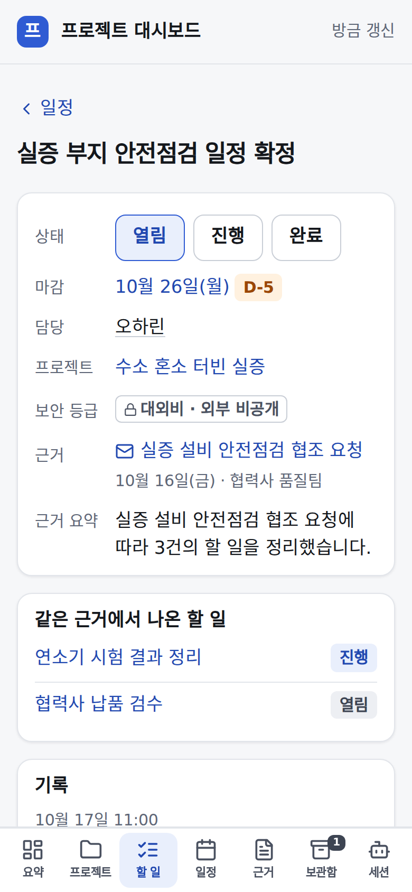
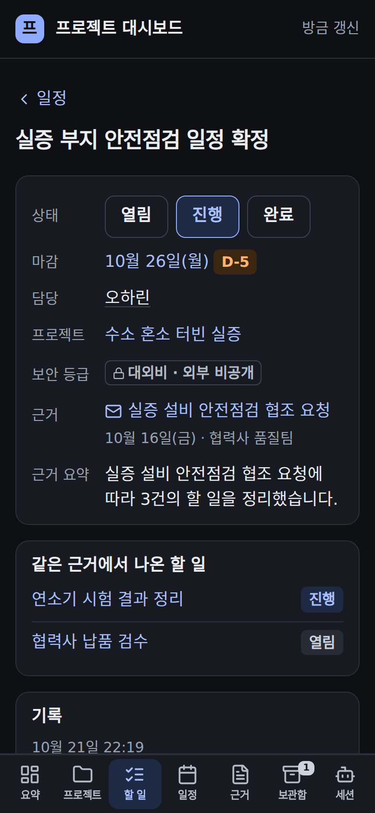
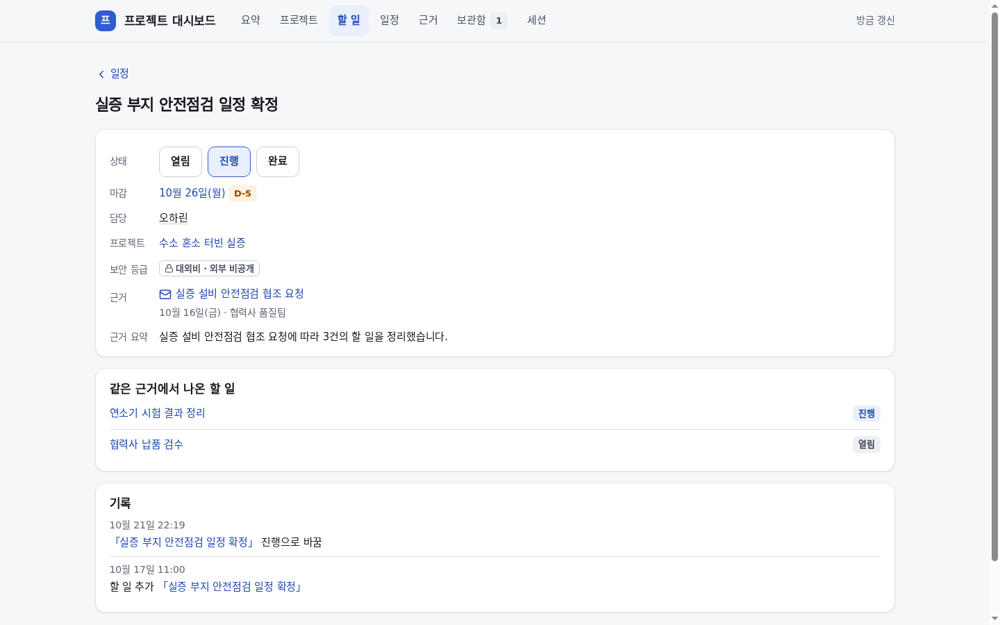
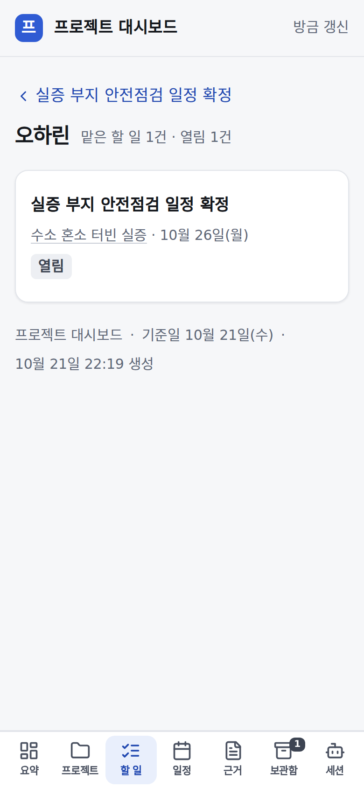
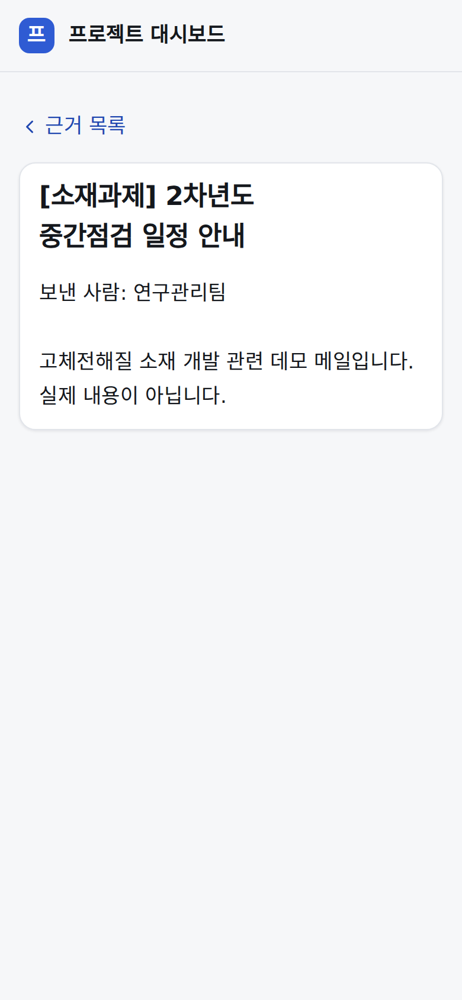
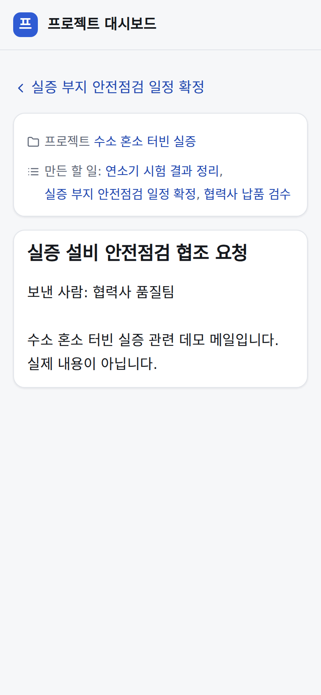
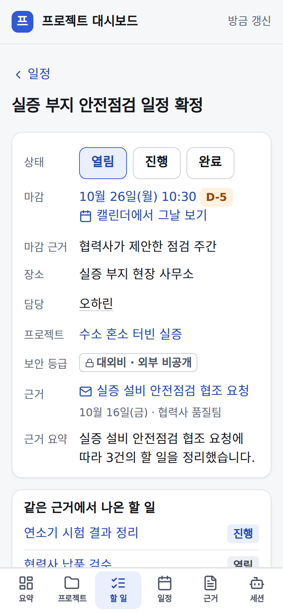
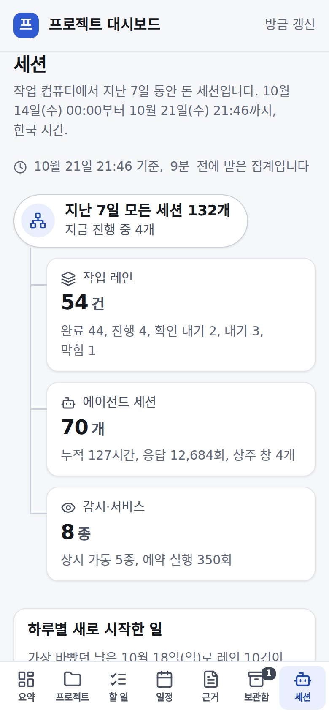
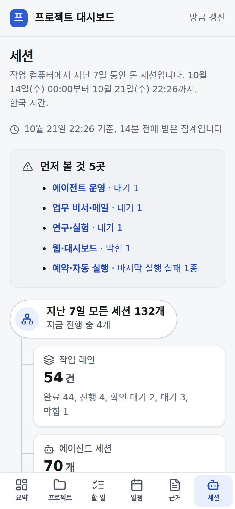

# 프로젝트 대시보드 — 누르면 그 정보로

## 무엇을
대시보드에 나오는 할 일·사람·프로젝트·메일마다 화면이 하나씩 있고(정본 하나), 어디서 눌러도 그 화면이 열린다. 할 일 화면에서
상태를 열림·진행·완료로 바로 바꾸고, 담당자·프로젝트·근거 메일·같은 메일의 다른 할 일로 이어진다. 뒤로 가면 보던 자리로 온다.

## 왜
일정 탭의 줄은 제목·프로젝트·날짜가 모두 글자뿐이라 눌러도 아무 데도 가지 않았다(2026-10-21 소유자 "일정 항목에서 개별 요소
클릭해도 해당 정보로 안넘어가져"). 뒤로 가기를 하면 늘 맨 위로 올라가 보던 자리를 잃었다.

## 사용 시나리오
- 휴대폰에서 일정 탭의 「실증 부지 안전점검 일정 확정」을 누른다 → 그 할 일 화면이 열린다(마감 10월 26일 D-5, 담당, 프로젝트,
  근거 메일과 보낸 곳, 메일 요약, 같은 메일의 다른 할 일, 기록). 「진행」을 누르면 저장되고 요약의 「진행 중」이 하나 는다.
  왼쪽 위 「‹ 일정」을 누르면 일정 탭의 같은 자리로 돌아온다.
- 승인된 메일이 시각·장소를 말했으면 할 일 화면에 「10월 26일(월) 10:30」·「장소」·「마감 근거」가 보이고, 「캘린더에서 그날 보기」가 형 캘린더의 그날을 연다.
- 세션 탭 맨 위 「먼저 볼 것」을 누르면 멈춘·대기 레인이나 실패한 예약 작업의 묶음이 펼쳐져 열린다. 세 요약 카드는 각 갈래로 간다.
- 할 일 화면에서 담당자 이름을 누르면 그 사람이 맡은 할 일 모두, 근거 메일을 누르면 원문이 열리고 원문의 돌아가기는 그 할 일로 온다.
- 일정 줄의 프로젝트 이름을 누르면 그 프로젝트 화면, 메일 제목 줄을 누르면 그 근거 원문이 열린다.
- 할 일 탭에서 검색어를 넣어 둔 채 일정에서 다른 할 일을 눌러도, 그 줄이 가려지지 않게 검색어가 비워진다. 접어 둔 묶음은 펼쳐진다.
- 보관한 프로젝트의 할 일도 자기 화면이 있어 보관함에서 눌러도 열린다. 저장이 실패하면 버튼 아래에 이유가 나오고 상태는 그대로다.

| 전(일정 줄이 글자뿐) | 후(제목·프로젝트·근거가 링크) | 후(누른 할 일이 강조) |
|---|---|---|
|  |  |  |

| 데스크톱 전 | 데스크톱 후 | 어두운 모드 전 | 어두운 모드 후 |
|---|---|---|---|
|  |  |  |  |

| 할 일 화면(폰) | 할 일 화면(폰·어두운) | 할 일 화면(데스크톱) | 사람 화면 |
|---|---|---|---|
|  |  |  |  |

| 원문 전(막다른 화면) | 원문 후(프로젝트·만든 할 일·온 화면으로) |
|---|---|
|  |  |

| 할 일 화면(시각·장소·근거) | 세션 탭 전 | 세션 탭 후(먼저 볼 것) |
|---|---|---|
|  |  |  |

캡처는 지어낸 데모 보드(`python3 -m automation.project_board demo`)다.

## 관련
- 화면: `automation/project_board/dashboard.py`(`todo_href`·`person_href`, `_todo_page`·`_person_page`, `_agenda_cards`, 탭 스크립트), 원문 `server.py`(`_source_links`), 테마 `dashboard_theme.py`
- 시험: `tests/unit/test_project_board_links.py`
- 규약: [프로젝트 대시보드 가이드](../guide/프로젝트-대시보드.md) 「누르면 그 정보로」. 승인·게이트 변화 없음(읽기 화면의 링크만).
