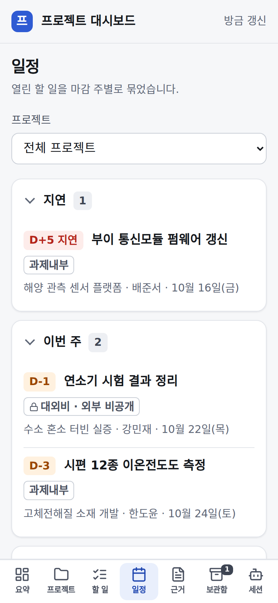
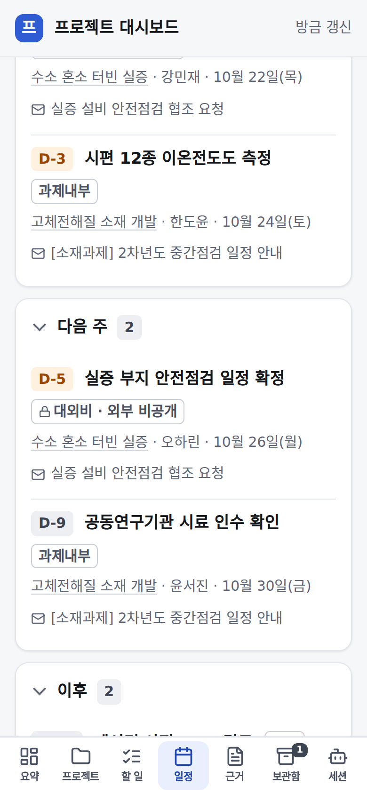
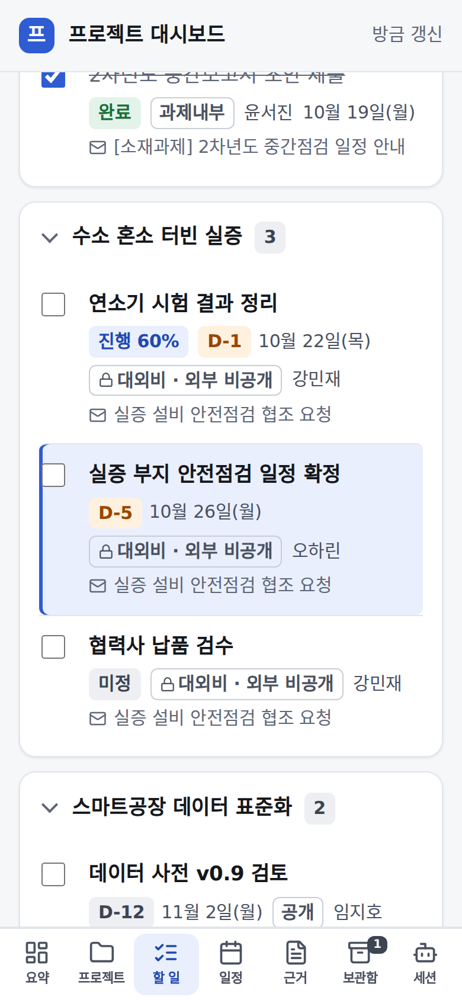
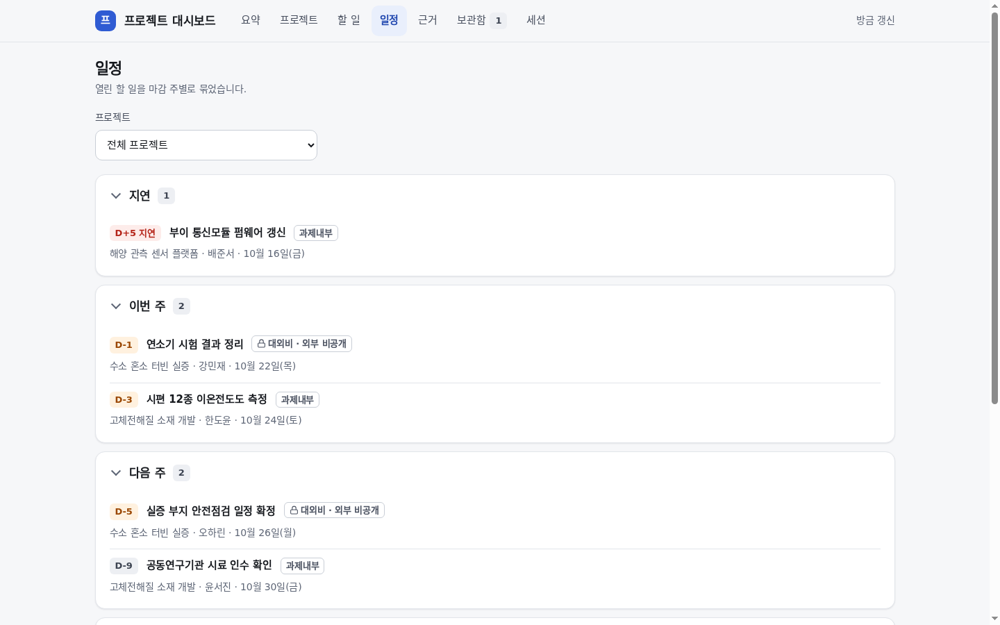
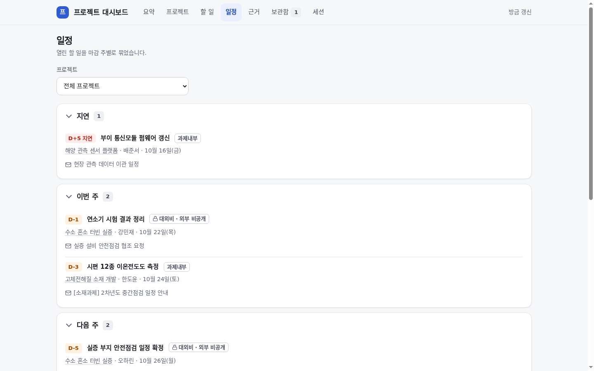
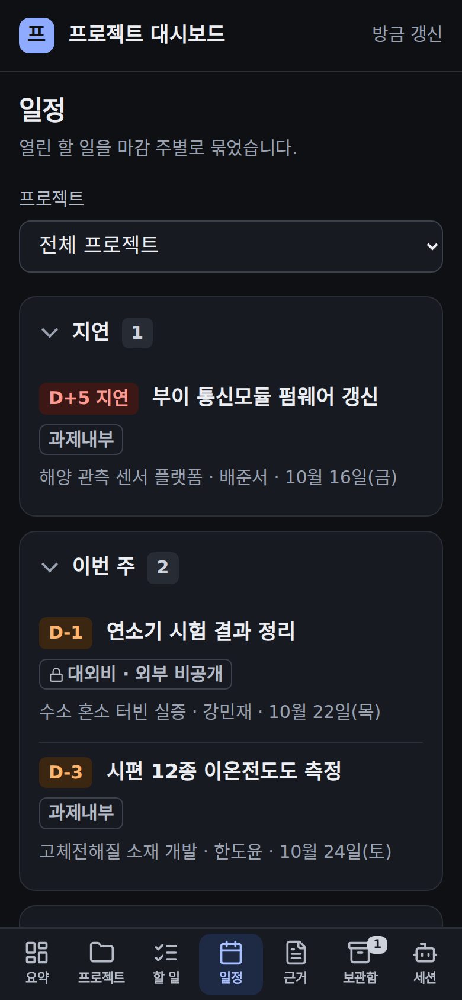
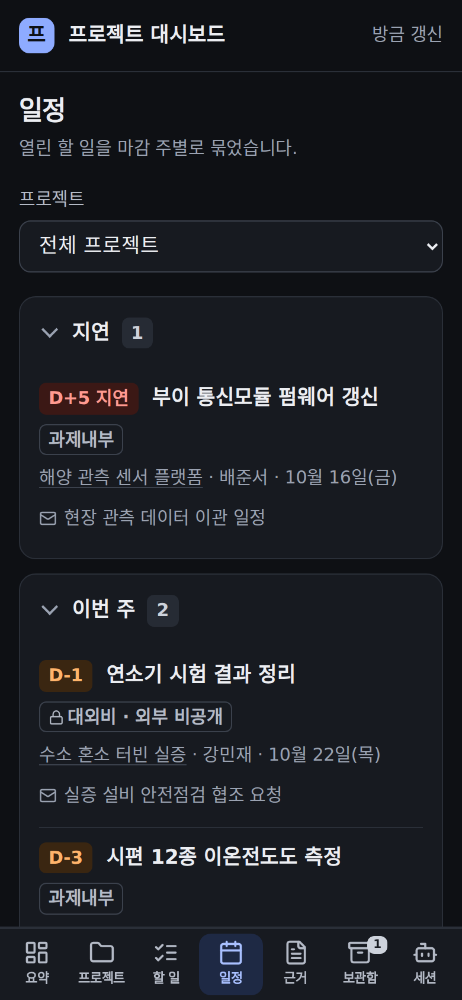

# 프로젝트 대시보드 — 누르면 그 정보로

## 무엇을
대시보드에 보이는 항목을 누르면 그 항목의 정보로 바로 가고, 브라우저 뒤로 가기로 보던 자리에 돌아온다. 첫 단계는 일정이다.

## 왜
일정 탭의 줄은 제목·프로젝트·날짜가 모두 글자뿐이라 눌러도 아무 데도 가지 않았다(2026-10-21 소유자 "일정 항목에서 개별 요소
클릭해도 해당 정보로 안넘어가져"). 뒤로 가기를 하면 늘 맨 위로 올라가 보던 자리를 잃었다.

## 사용 시나리오
- 휴대폰에서 일정 탭을 내려 「실증 부지 안전점검 일정 확정」 제목을 누른다 → 할 일 탭이 열리고 그 줄이 강조되어 화면 가운데에
  온다. 체크하면 바로 완료로 남는다. 뒤로 가기를 누르면 일정 탭의 같은 자리로 돌아온다.
- 일정 줄의 프로젝트 이름을 누르면 그 프로젝트 화면, 메일 제목 줄을 누르면 그 근거 원문이 열린다.
- 할 일 탭에서 검색어를 넣어 둔 채 일정에서 다른 할 일을 눌러도, 그 줄이 가려지지 않게 검색어가 비워진다. 접어 둔 묶음은 펼쳐진다.
- 보관한 프로젝트의 일정 줄은 할 일 탭에 없으므로 제목이 링크가 아니다(누를 곳이 없는 링크를 만들지 않는다).

| 전(일정 줄이 글자뿐) | 후(제목·프로젝트·근거가 링크) | 후(누른 할 일이 강조) |
|---|---|---|
|  |  |  |

| 데스크톱 전 | 데스크톱 후 | 어두운 모드 전 | 어두운 모드 후 |
|---|---|---|---|
|  |  |  |  |

캡처는 지어낸 데모 보드(`python3 -m automation.project_board demo`)다.

## 관련
- 화면: `automation/project_board/dashboard.py`(`_agenda_cards`, 탭 스크립트의 `reveal`·뒤로 가기 자리), 테마 `dashboard_theme.py`
- 시험: `tests/unit/test_project_board_links.py`
- 규약: [프로젝트 대시보드 가이드](../guide/프로젝트-대시보드.md) 「누르면 그 정보로」. 승인·게이트 변화 없음(읽기 화면의 링크만).
