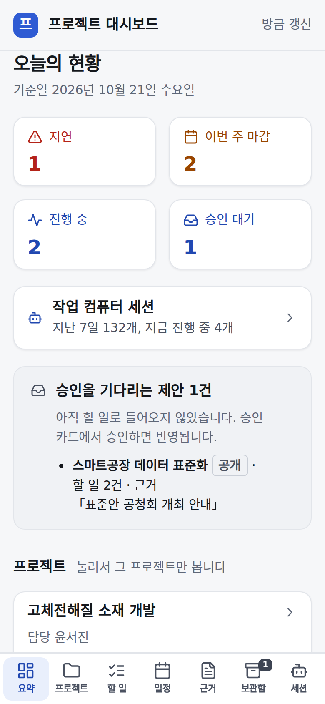
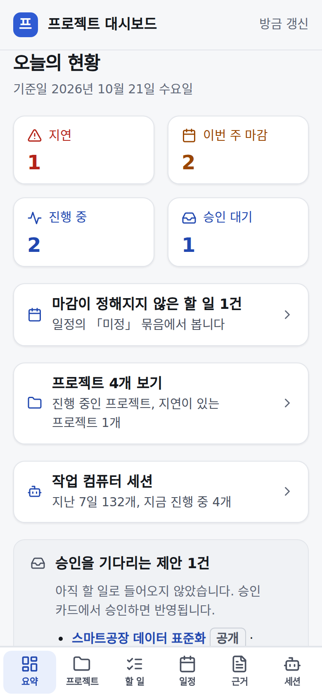
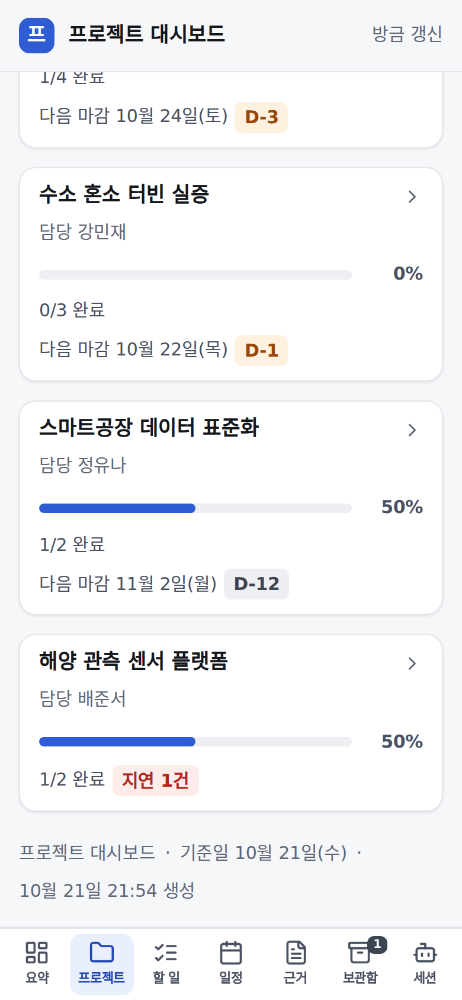
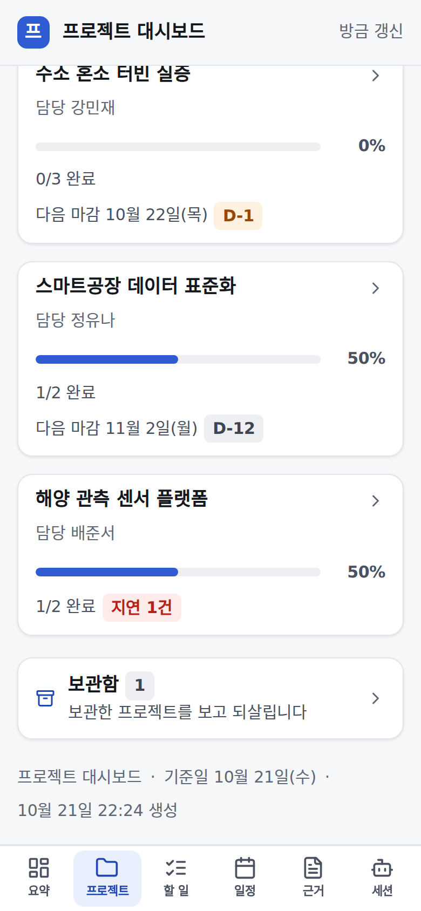
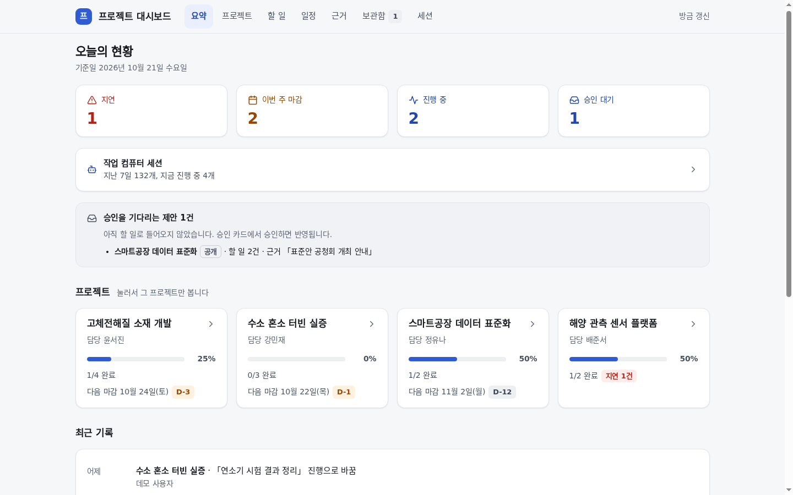
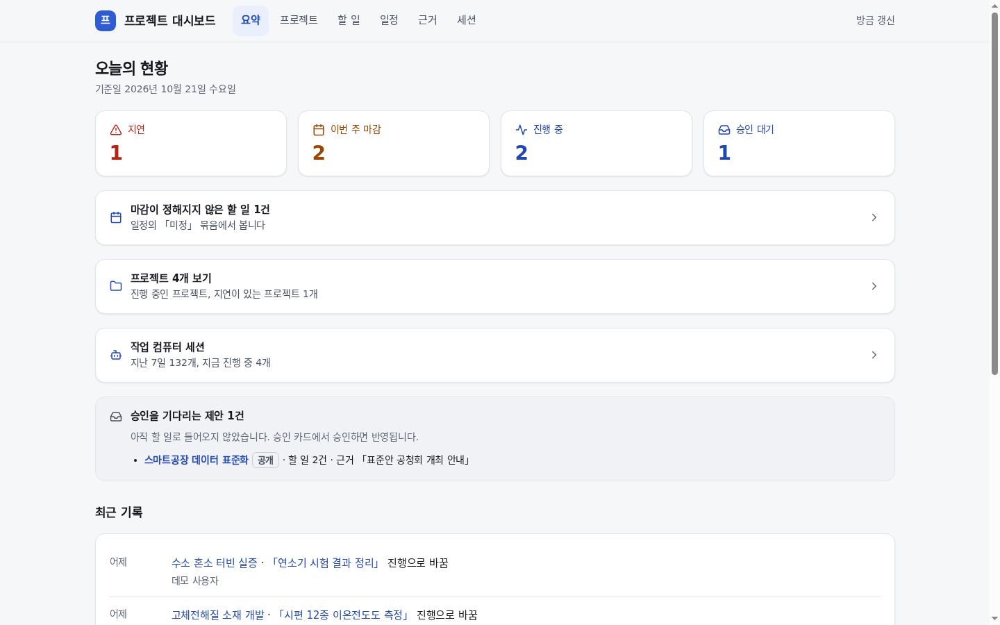
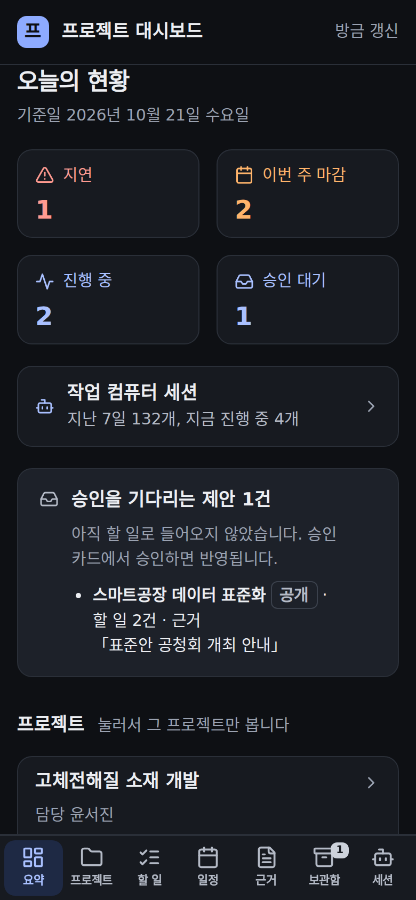
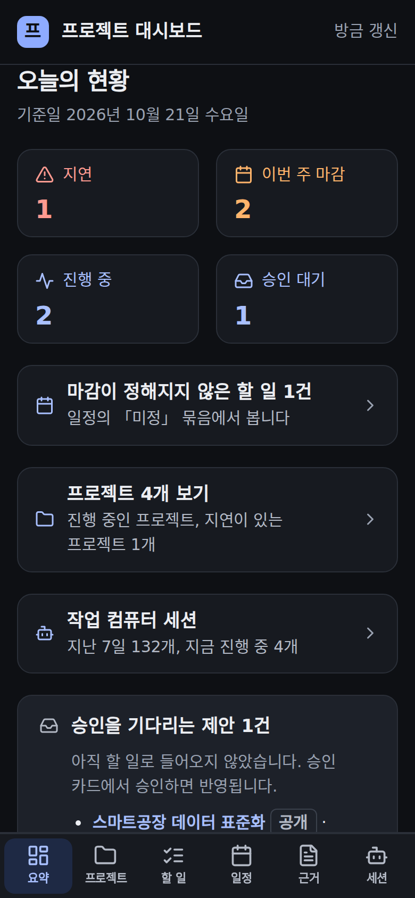

# 프로젝트 대시보드 — 요약이 쓸모 있게

## 무엇을
요약의 칸마다 누르면 그 내용으로 바로 간다. 비어 있기만 하던 칸은 실제 데이터가 있는 칸으로 바꾸고, 같은 내용을 두 번 그리던
부분은 한 줄로 줄였다.

## 왜
2026-10-21 소유자: "진행중과 승인 대기 항목도 거의 활성화 안되는 상태인것 같아", "이렇게 공간만 차지하는 기능을 모두 쓸모있게 해".
진행 중은 화면에서 진행으로 바꿀 길이 없어 늘 비었고(할 일 화면의 열림·진행·완료 버튼으로 해결, [누르면 그 정보로](프로젝트-대시보드-연결성.md)),
승인 대기는 프로젝트 보드가 카드 없이 바로 반영되면서(2026-10-18 결정) 늘 0이었다. 요약의 프로젝트 카드는 프로젝트 탭과 똑같았고,
보관함 탭은 한 번도 쓰이지 않은 채 휴대폰 아래 탭 한 칸을 차지했다.

## 사용 시나리오
- 요약의 「지연 1」을 누른다 → 일정 탭의 지연 묶음이 펼쳐진 채 열린다. 「이번 주 마감」은 이번 주 묶음으로 간다.
- 「진행 중 2」를 누른다 → 할 일 탭이 상태 「진행」으로 걸러져 그 두 건만 보인다. 아래 탭 「할 일」로 다시 오면 필터가 풀린다.
- 승인을 기다리는 제안이 없으면 그 칸은 「최근 7일 새 할 일 N」이 되고 누르면 최근 기록으로 간다. 대기가 생기면 다시 「승인 대기」가 된다.
- 「마감이 정해지지 않은 할 일 N건」을 누르면 일정의 「미정」 묶음으로 간다. 프로젝트 화면의 칸도 승인 대기가 없으면 「마감 미정 N」(그 프로젝트 일정으로)이 된다.
- 요약의 「프로젝트 N개 보기」는 프로젝트 탭으로, 프로젝트 탭 맨 아래 「보관함 N」은 보관한 프로젝트 화면으로 간다(옛 `#archive` 주소도 그대로).

| 요약 전 | 요약 후 | 프로젝트 탭 끝 전 | 프로젝트 탭 끝 후 |
|---|---|---|---|
|  |  |  |  |

| 데스크톱 전 | 데스크톱 후 | 어두운 모드 전 | 어두운 모드 후 |
|---|---|---|---|
|  |  |  |  |

캡처는 지어낸 데모 보드(`python3 -m automation.project_board demo`)다.

## 관련
- 화면: `automation/project_board/dashboard.py`(`_summary`, `_shelf_link`, `_BUCKET_IDS`, 탭 스크립트의 `?s=`·`sched-` 주소), 테마 `dashboard_theme.py`
- 시험: `tests/unit/test_project_board_summary_links.py`
- 소유자 결정 Q346·Q347(2026-10-21). 승인·게이트 변화 없음.
