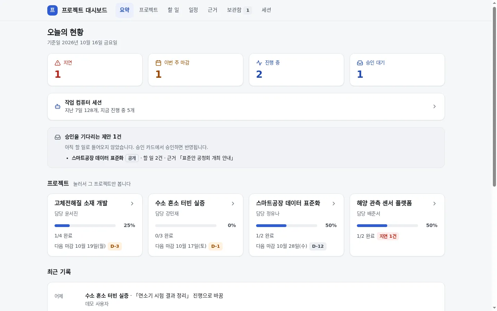
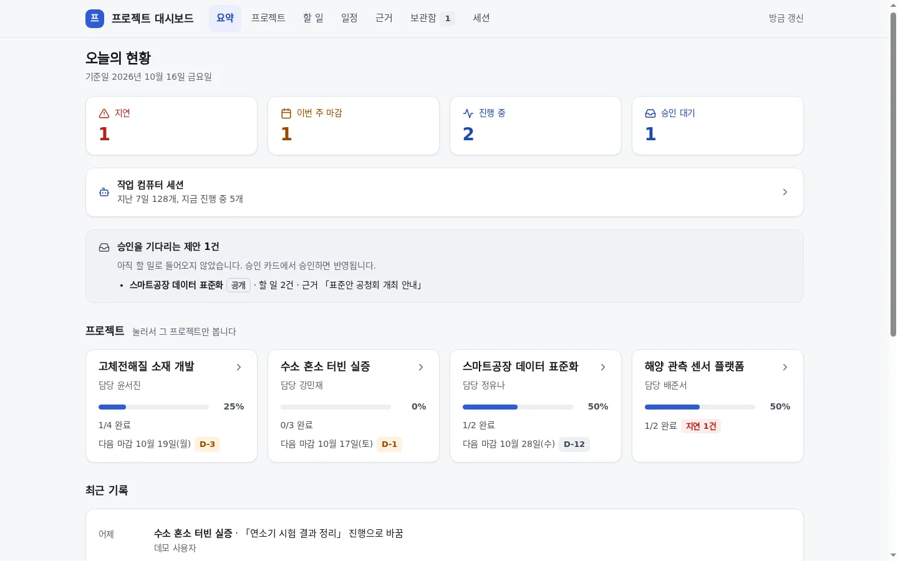
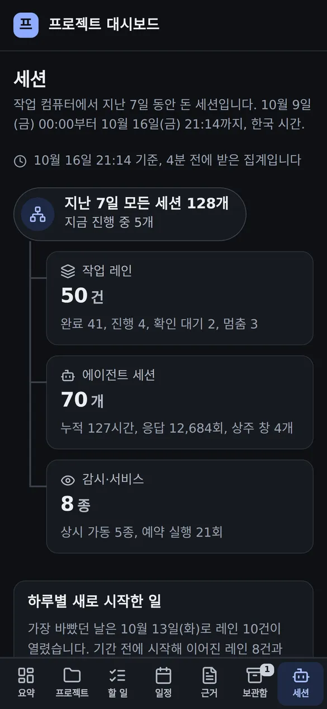
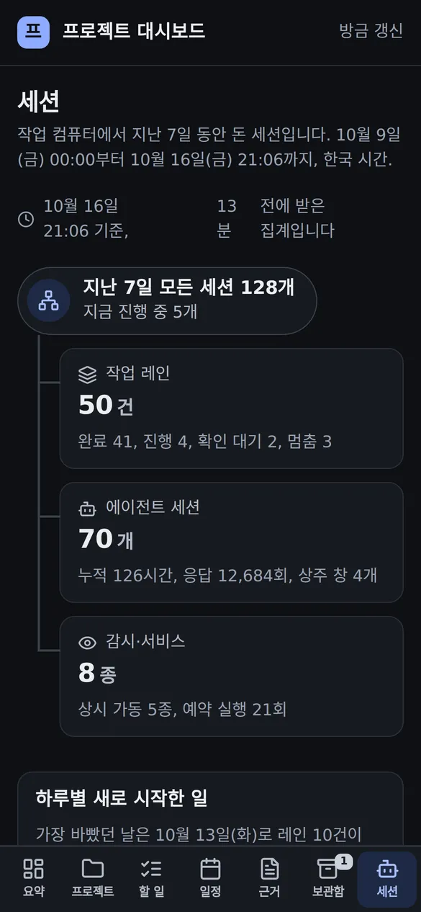
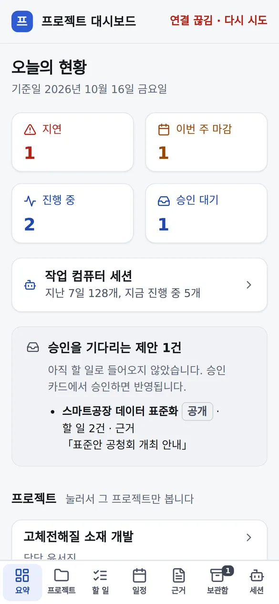

# 프로젝트 대시보드 자동 갱신

## 무엇을
열어 둔 대시보드가 저절로 최신이 된다. 화면이 보이는 동안 2분마다 바뀐 것이 있는지만 묻고, 바뀐 화면 덩어리만
새것으로 바꾼다. 보던 탭·프로젝트·스크롤 위치·펼친 묶음·검색어는 그대로다. 머리 오른쪽에 「방금 갱신」·「3분 전 갱신」이
보이고, 받지 못하면 같은 자리에 오류 색 한 줄이 나온다.

## 왜
2026-10-16 소유자 결정 Q192: "화면을 보고 있을 때 2분마다 새 데이터만 조용히 받아서 바꾸기(스크롤·펼친 상태 유지)".
그전에는 할 일 체크·보관 버튼을 누른 뒤에만 화면을 다시 그렸다. 대시보드를 열어 둔 채 다른 일을 하다 돌아오면
✅ 로 반영된 할 일, 새 세션 집계가 보이지 않아 직접 새로 고쳐야 했고, 새로 고치면 보던 자리와 펼친 묶음이 풀렸다.

## 전과 후 (지어낸 데모 데이터)
| 화면 | 전 | 후 |
|---|---|---|
| 요약(데스크톱) |  |  |
| 세션(휴대폰, 어두운 모드) |  |  |
| 받기 실패(휴대폰) | 표시 없음 |  |

## 사용 시나리오
- 할 일 탭을 열고 「열림」만 고른 채 아래로 내려 보다가 자리를 비운다. 그사이 승인 카드 ✅ 로 할 일 하나가 완료되면,
  다음 2분 주기에 그 줄이 목록에서 빠지고 바로 아래 줄이 화면에서 같은 높이에 남는다. 접어 둔 프로젝트 묶음은 접힌 채다.
- 바뀐 것이 없으면 서버는 본문 없이 304 로 답하고 화면은 하나도 바뀌지 않는다. 「N분 전 갱신」만 「방금 갱신」으로 돌아간다.
- 다른 탭으로 옮기거나 창을 내리면 묻지 않는다(요청 0). 다시 보면 바로 한 번 묻는다.
- 검색 칸에 글자를 치는 동안에는 할 일 목록을 바꾸지 않고, 칸을 벗어나면 친 글자를 지닌 채 바뀐다.
  보관 확인 대화상자가 열려 있거나 체크를 저장하는 중이면 그 주기는 건너뛴다.
- 연결이 끊기면 「연결 끊김 · 다시 시도」, 접속 키가 바뀌었으면 「다시 로그인 필요」가 오류 색으로 나오고 화면 읽기 도구가
  이유를 한 번 읽는다. 보던 내용은 그대로이고 2분 뒤 다시 묻는다. 다시 받으면 「방금 갱신」으로 돌아온다.

## 관련
- 코드: `automation/project_board/dashboard.py`(`_REFRESH_JS`, `stamp_etag`), `server.py`(ETag·304), `sessions_view.py`(집계 나이 `data-ago`),
  시험 `tests/unit/test_project_board_refresh.py`. 규약: [프로젝트 대시보드 §4 화면 「저절로 최신」](../guide/프로젝트-대시보드.md).
- 승인·외부효과 없음(읽기만). 메일 첨부용 파일 사본에는 이 기능이 없다.
