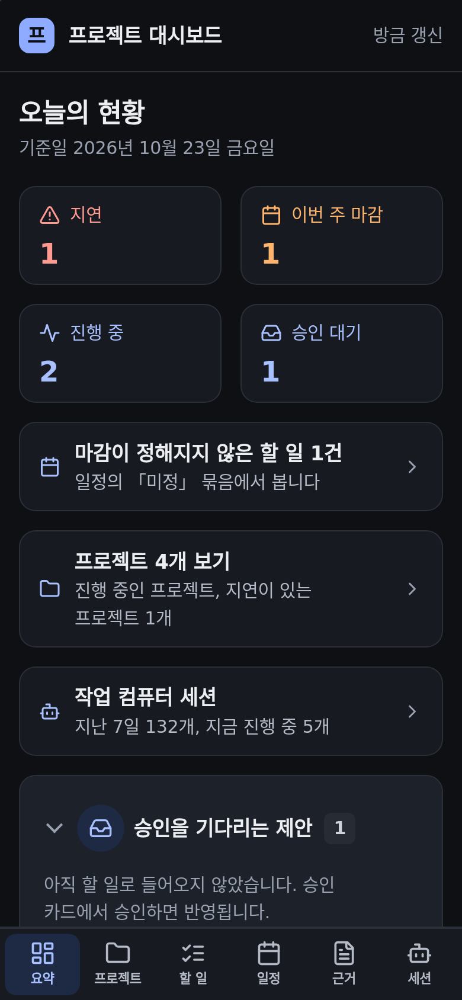
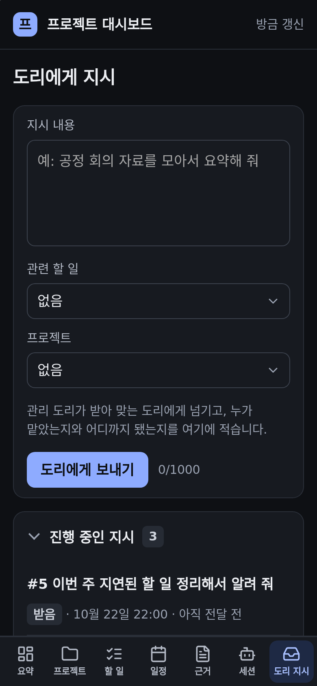
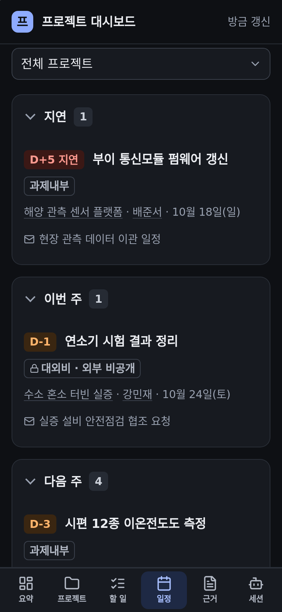
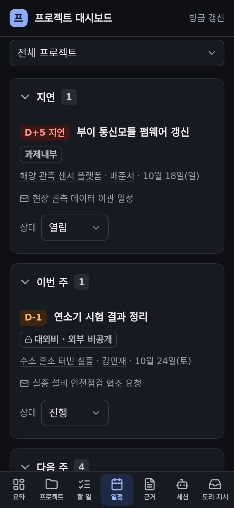
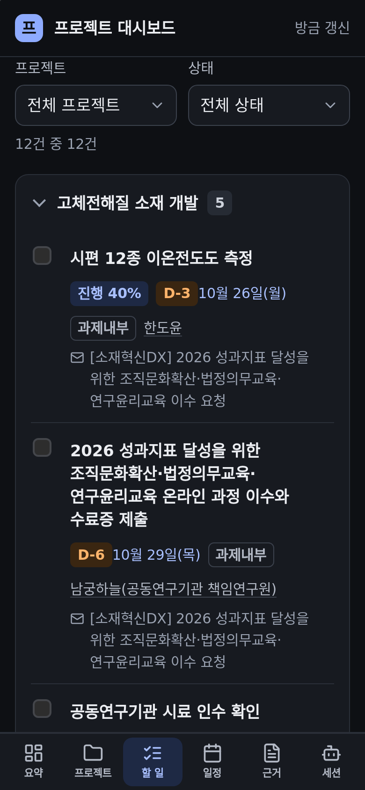
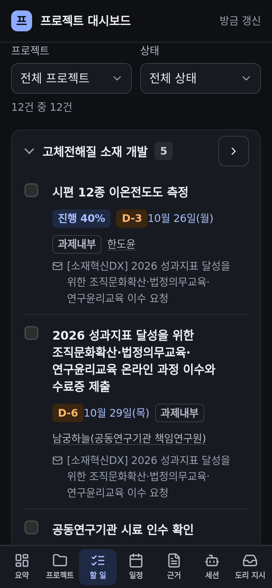

# 대시보드 탭 정리: 장부 대신 도리 지시, 막히는 데 없이

## 무엇을

대시보드 하단 일곱 번째 탭이 「장부」에서 「도리 지시」로 바뀌었다. 그와 함께 형처럼 눌러 보다 걸린 동작을 고쳤다.
원문을 보고 와도, 새로 고쳐도, 탭을 오가도 보던 자리가 그대로다. 일정 탭의 각 줄에서 할 일 상태(열림·진행·완료)를 바로 바꾼다.
할 일 묶음 머리는 어디를 눌러도 접히고, 프로젝트 화면의 돌아가기는 그 화면을 연 곳으로 간다. 내려받을 수 없는 가짜 첨부(웹메일의
「Download all」·「Save」 글자)는 더 보이지 않는다.

## 왜

2026-10-23 형 말: "대시보드에서 장부 아이템은 하나도 클릭이 안되는데 이럴 바에는 도리에게 시키기를 그 탭으로 옮기고 그 탭은 없어버리는게
안나? 탭들이 실제로 유용한지 다시 한번 검토해봐 QA 니가 꼭 해봐 내가 쓰는 것처럼 썼을 때 이상한 동작이 없는지 검증해". 실데이터 사본으로
링크 449개를 폰(사파리 엔진 390)과 데스크톱에서 하나씩 눌러 보았다. 장부 탭은 238줄 가운데 누를 수 있는 줄이 하나도 없었다. 대부분 끝난
기록이라 형이 거기서 할 일도 없었다. 폰에서는 메일 원문을 보고 돌아오거나 새로 고치면 목록 맨 위로 튀었고(98개 링크), 메일 10통의 첨부 칩
20개는 누르면 「찾을 수 없음」이었다. 형은 카드 Q360에서 「장부 탭 없애고 그 자리에 '도리에게 지시' 탭」을 골랐다. 같은 날 10:48에는
"일정 상태를 열림 진행 완료로 … 일정 탭에서도 좀 편하게 바꿀 수 있는 게 있으면 좋겠어"를 더했다.

## 사용 시나리오

- 형이 폰으로 할 일 탭을 한참 내려 근거 메일 제목을 누른다. 원문을 읽고 「할 일」 돌아가기(또는 뒤로 가기)를 누르면 방금 보던 줄로 돌아온다.
  일정 탭으로 갔다가 할 일 탭을 다시 눌러도 그 자리다. 이미 연 탭을 한 번 더 누르면 맨 위로 간다.
- 일정 탭의 한 줄 아래 「상태」 칸을 누르면 열림·진행·완료 세 줄이 키보드 없이 뜬다. 「진행」을 고르면 그 줄이 바로 바뀌고 「진행으로
  바꿨습니다」가 읽힌다. 「완료」를 고르면 줄에 줄이 그어지고, 화면이 새로 받아지면 일정에서 빠진다(할 일 탭에는 남는다). 저장은 할 일 화면의 상태 버튼과 같은 길(`POST /todo/<id>`)이다. 연결이 끊기거나 권한이 없으면 칸이 원래 값으로
  돌아가고 그 줄 아래에 이유가 나온다.
- 하단 「도리 지시」 탭에서 지시를 쓰고 진행·결과를 본다. 요약의 지시 상자(이름도 「도리 지시」)의 「지시 쓰기」·「지시 탭에서 전부 보기」로 와도 같은 탭이 켜지고 쓰기 칸이 화면에 보인다.
  할 일 화면의 「이 할 일로 도리에게 지시」로 열면 위에 그 할 일로 돌아가는 링크가 생긴다.
- 할 일 탭 프로젝트 묶음의 이름을 누르면 접힌다. 프로젝트 화면으로는 머리 끝의 「프로젝트」 버튼(폰에서는 꺾쇠 버튼)으로 간다.

## 전과 후 (데모 보드, 폰 390·어두운 모드)

| 전 | 후 |
|---|---|
|  |  |
|  |  |
|  |  |

## 관련

- 화면: `automation/project_board/dashboard.py`(`TABS`·`_TABS_JS`의 `pb-seen`·`settle`, `_status_pick`, `_todos`, `_project_page`),
  `orders_view.py`(지시 탭의 돌아가기), `server.py`(`_servable`: 보관된 파일이 있는 첨부만), `DESIGN.md`
- 시험: `tests/unit/test_project_board_tab_review.py`, 레이아웃 `layout_audit.mjs`
- 장부 데이터와 명령(`automation/ledger/`)은 그대로다. 지난 회의 액션은 지우지 않고 유돌이 형에게 물어 옮긴다.
- 승인·게이트: 새 쓰기 길 없음. 상태 바꾸기는 기존 할 일 저장과 같은 권한(토큰+같은 출처 또는 허용 로그인)을 쓴다.
