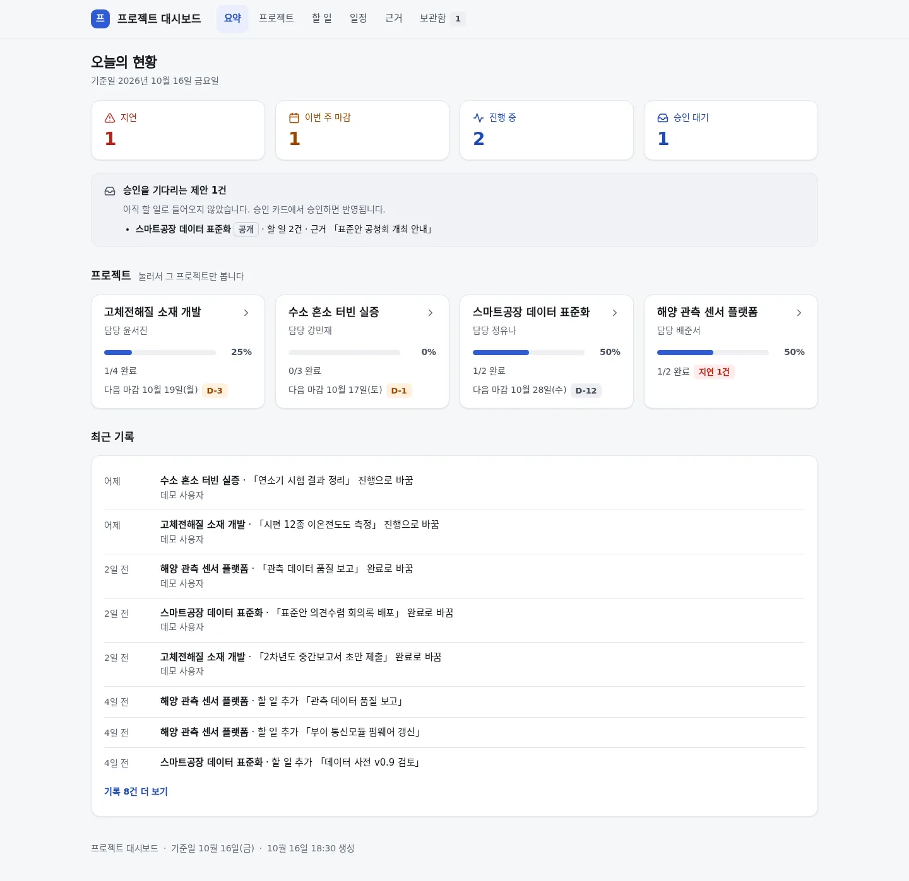
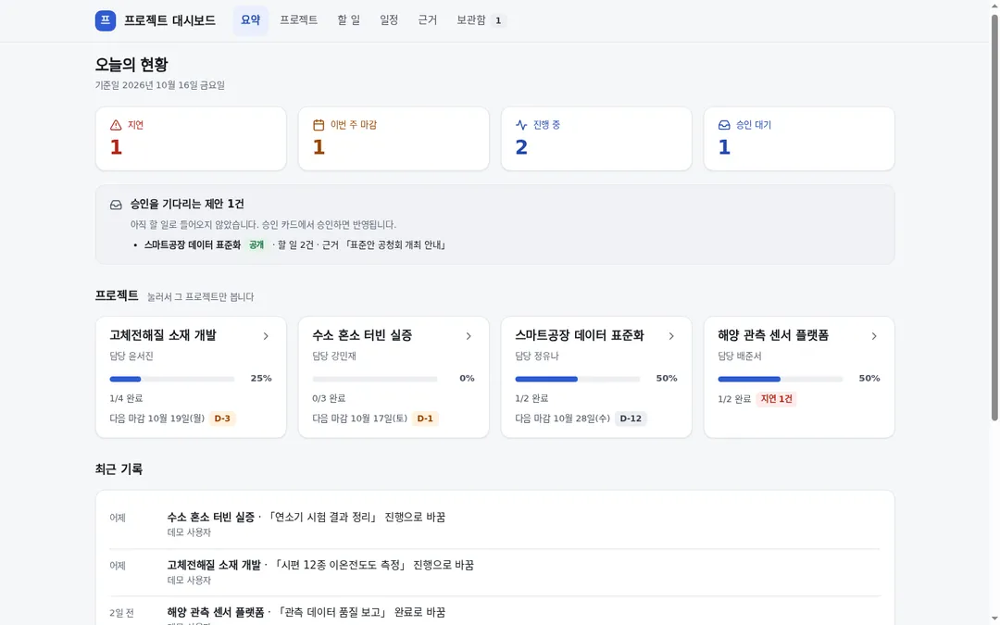
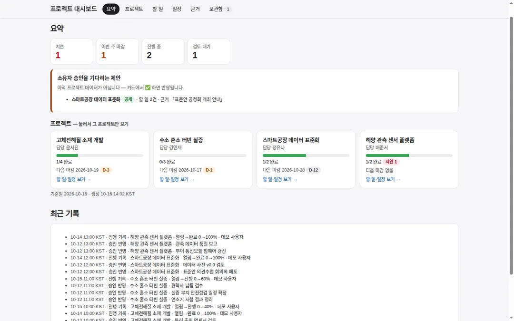
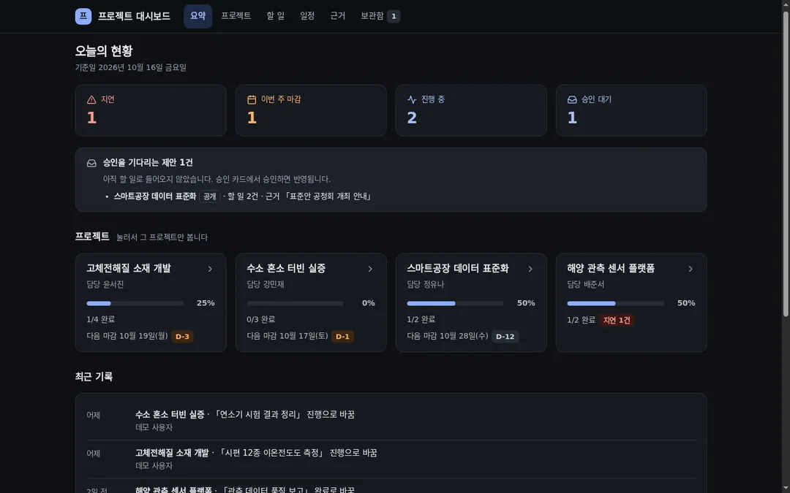
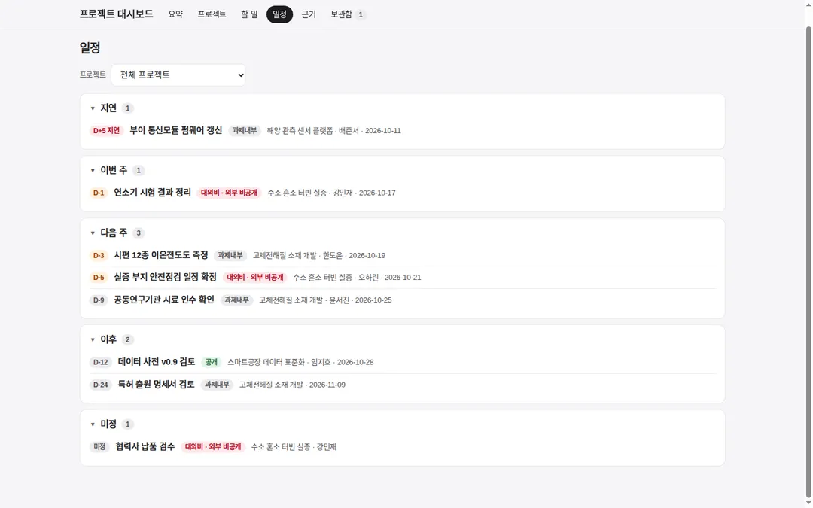
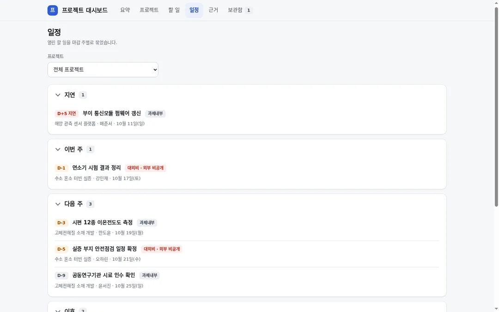
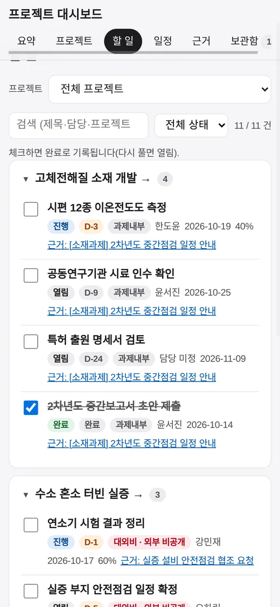
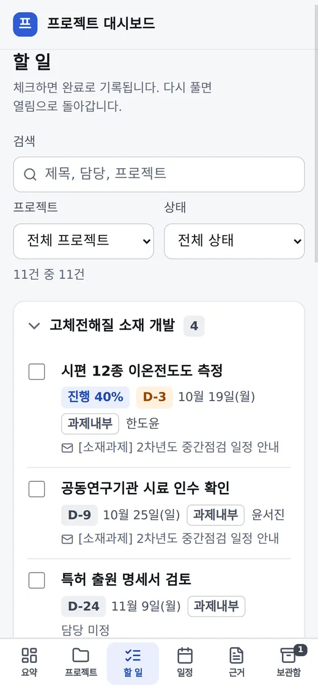
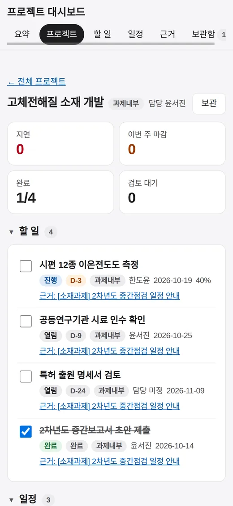
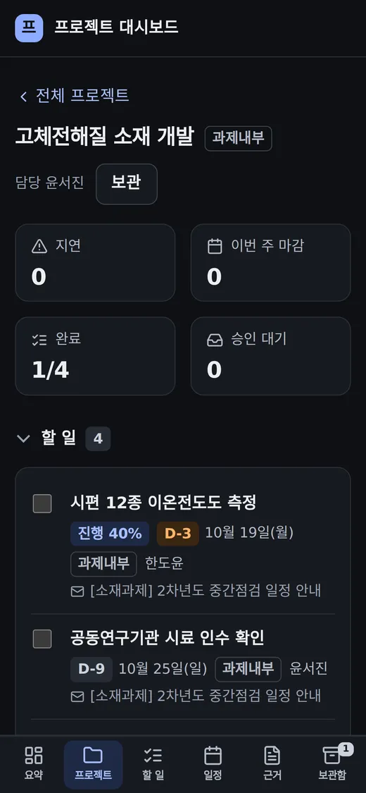

# 프로젝트 대시보드 판매용 화면

## 무엇을
프로젝트 대시보드를 다른 연구실·기관에 보여 줄 수 있는 제품 수준의 화면으로 바꿨다. 색·간격·글자는 토큰 한 벌에서 나오고
어두운 모드가 기기 설정을 따른다. 브랜드 자리와 파비콘이 생겼고, 휴대폰에서는 탭이 화면 아래 탭 막대가 된다. 지표는
아이콘이 붙은 타일로, 프로젝트 카드는 진척 퍼센트와 다음 마감으로, 최근 기록은 사람이 읽는 문장으로 보인다.

## 왜
2026-10-16 소유자 지시: "프로젝트 대시보드 ui를 개선해서 판매용으로 만들어줘." 이전 화면은 어두운 모드가 없었고, 휴대폰에서
탭이 잘리고 누를 곳이 44px보다 작았으며(화면당 6~24곳), 기록이 `열림→완료 0→100%` 같은 기계 문자열이었다. 승인 대기 카드는
한쪽 색 테두리와 이모지를 썼고 브랜드 자리와 파비콘이 없었다.

## 전과 후 (지어낸 데모 데이터)
| 전 | 후 |
|---|---|
|  |  |
|  |  |
|  |  |
|  |  |
|  |  |

## 사용 시나리오
- 소유자가 아침에 휴대폰으로 대시보드를 연다. 「오늘의 현황」 타일에서 지연 1건을 누르면 일정 탭이 열리고, 아래 탭 막대로
  할 일·근거를 오간다. 기기가 어두운 모드면 화면도 어둡다.
- 다른 기관 책임자에게 보여 줄 때는 `python3 -m automation.project_board demo` 로 지어낸 데이터 보드를 띄운다. 실제 과제·사람·메일은
  화면에 나오지 않는다.
- 노드에서 직접 체크하면 최근 기록에 「이 기기에서」로 남고, 접속 주소는 화면에 나오지 않는다.

## 관련
- `automation/project_board/dashboard_theme.py`(토큰·스타일·아이콘), `automation/project_board/dashboard.py`(화면)
- 검증: `tests/unit/test_project_board_design.py`(토큰 밖 색 금지, 인라인 스타일·em-dash·이모지 금지, 44px 체크 영역, 기록 문장, 「이 기기에서」)
- 규약: [docs/guide/프로젝트-대시보드.md](../guide/프로젝트-대시보드.md) 「4. 화면」의 「모양」
