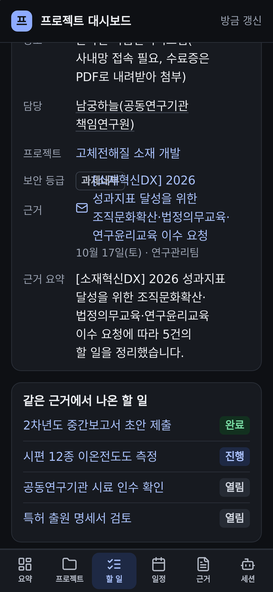
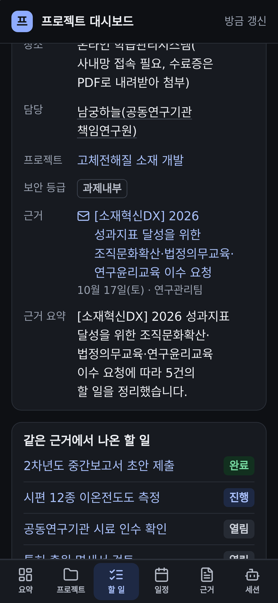
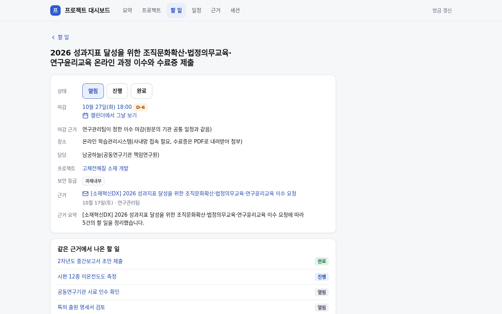
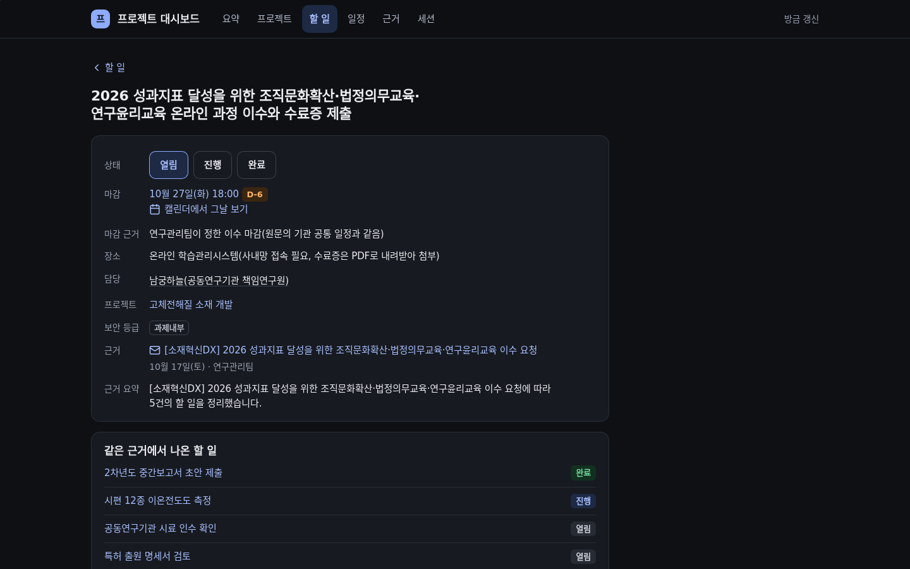

# 프로젝트 대시보드 — 폰에서 줄이 겹치지 않고 다 읽히게

## 무엇을
할 일 화면의 각 줄(상태·마감·장소·담당·프로젝트·보안 등급·근거)이 내용이 길어도 자기 높이를 갖고, 긴 메일 제목은 「…」로 잘리지 않고
줄을 바꿔 끝까지 보이며, 일정·사람 줄과 요약의 기록·승인 대기 줄의 구분점 「·」은 줄 맨 앞으로 떨어지지 않고 앞 항목 끝에 붙는다. 그리고 대시보드의 모든 탭과 상세 화면을 폰(390)·데스크톱(1440), 밝은·어두운 모드, 사파리 엔진(WebKit)과
크롬에서 열어 겹침·잘림·화면 밖 글자·줄 맨 앞 구분점·가로 스크롤·너무 작은 글씨·아래 탭에 가린 내용을 찾는 감사 도구(`layout_audit.mjs`)가 생겼다.

## 왜
형이 아이폰에서 할 일 화면을 열었을 때 「보안 등급」의 「과제내부」 배지와 그 아래 「근거」 줄의 긴 메일 제목이 같은 자리에 겹쳐 그려졌다
(2026-10-21 소유자 "이런 깨짐있어 모바일 용qa진행해"). 사파리는 글자 기준선으로 맞춘 표 줄 안에서 여러 줄로 접힌 링크를 만나면 그 줄을
위 줄 높이로 끌어올린다. 크롬에서는 생기지 않아, 넘침·작은 대상만 재던 이전 감사가 놓쳤다. 일정·할 일 줄의 긴 메일 제목도 「…」로
잘려 끝을 읽을 수 없었고, 담당 이름이 길면 「· 10월 27일(화)」처럼 구분점이 새 줄을 시작했다(터치 높이 때문에 링크가 `inline-block`이라 그 뒤가 늘 줄바꿈 자리였다).

## 사용 시나리오
- 형이 폰에서 제목·담당·근거가 긴 할 일을 연다 → 줄마다 위쪽을 맞춰 차례로 쌓이고, 근거 메일 제목은 세 줄이 되어도 보안 등급 배지 아래에서 시작한다.
- 일정 탭의 메일 제목 줄이 길면 두세 줄로 접혀 끝까지 보인다. 누르면 그 원문이 열리는 것은 그대로다.
- 화면을 고친 사람은 `layout_audit.mjs`를 돌린다 → 가짜 데이터 데모를 스스로 띄워 모든 화면을 열고, 찾은 것마다 `FINDING` 한 줄을 찍고 종료 코드 1로 끝난다. 아무것도 없으면 0이다.
- 일정 줄에서 담당 이름이 길어 줄이 바뀌어도 「·」은 이름 뒤에 붙고 다음 줄은 날짜부터 시작한다.
- 이 수정을 되돌리면 같은 감사가 사파리 폰 화면에서 겹침과 잘림을 다시 찾아 실패한다.

| 전(폰) | 후(폰) | 전(폰·어두운) | 후(폰·어두운) |
|---|---|---|---|
|  |  |  |  |

| 데스크톱 전 | 데스크톱 후 | 데스크톱 어두운 후 | 일정 줄 전 | 일정 줄 후 |
|---|---|---|---|---|
|  |  |  |  |  |

화면은 모두 데모의 가짜 데이터다(형 실데이터 아님).

## 관련
- 화면: `automation/project_board/dashboard_theme.py`(할 일 표 `.td-facts` 위쪽 맞춤, 근거 링크 `.src-link` 줄바꿈, 구분점 `.glue`), `dashboard.py` `_glued`
- 감사: `automation/project_board/layout_audit.mjs`, 가드 시험 `tests/unit/test_project_board_design.py`
- 데모 데이터: `automation/project_board/demo.py`(형 메일과 같은 길이의 가짜 제목·담당·장소)
- 승인·게이트 관여 없음(화면 그리기만 바뀜, 저장·인증 경로 그대로). 규약: `docs/guide/프로젝트-대시보드.md` 「화면 감사」
